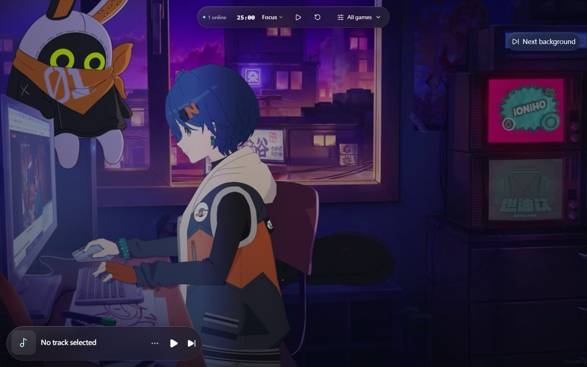
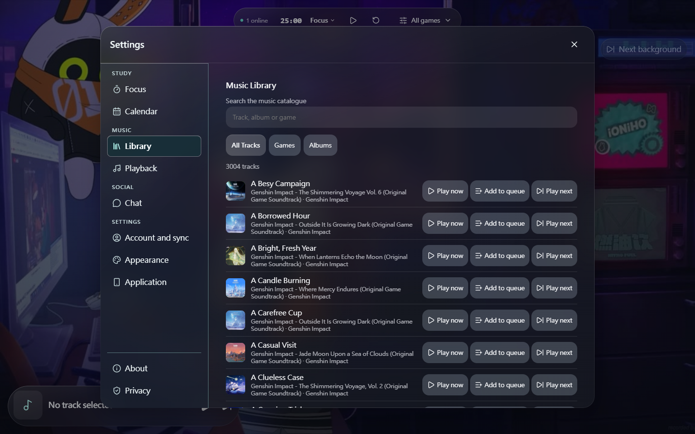
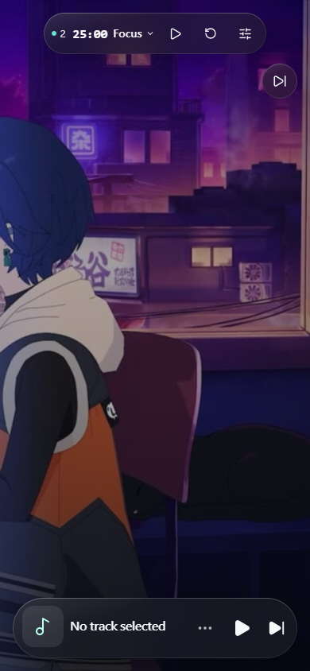
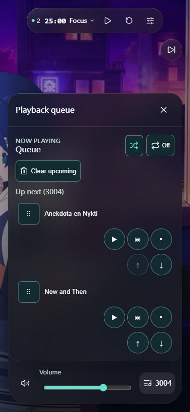

<div align="center">


# Study with HOYO-MiX

**An unofficial, non-commercial fan-made study & focus music workspace featuring HOYO-MiX soundtracks.**

<p align="center">
  <strong>English</strong> |
  <a href="./README.zh_CN.md">简体中文</a> |
  <a href="./README.zh_TW.md">繁體中文</a>
</p>

<p align="center">
  <a href="https://github.com/NullOkami47/study-with-hoyomix/actions/workflows/public-ci.yml"></a>
  <a href="LICENSE"></a>
  <a href="https://github.com/NullOkami47/study-with-hoyomix/commits/main"></a>
  <a href="https://github.com/NullOkami47/study-with-hoyomix/stargazers"></a>
  <a href="https://app.study-with-hoyomix.workers.dev"></a>
</p>

<p align="center">
  
  
  
  
</p>

<p align="center">
  <a href="#screenshots">Screenshots</a> •
  <a href="#capabilities">Capabilities</a> •
  <a href="#implemented">Implemented</a> •
  <a href="#architecture-and-modules">Architecture</a> •
  <a href="#planned-features">Planned Features</a> •
  <a href="#tech-stack">Tech Stack</a> •
  <a href="#quick-start">Quick Start</a> •
  <a href="#continuous-integration">CI</a> •
  <a href="#project-layout">Layout</a> •
  <a href="#credits">Credits</a> •
  <a href="#links">Links</a> •
  <a href="#license">License</a>
</p>

</div>

---

## 📝 Project Description

**Study with HOYO-MiX** ([`NullOkami47/study-with-hoyomix`](https://github.com/NullOkami47/study-with-hoyomix)) is a calm, dark-mode study and focus web workspace built around a WebGPU / WebGL2 / baked-tile / CSS **Liquid Glass** interface, durable Pomodoro & sleep timers, multi-provider playback orchestration with transitions & unified recovery, anonymous-first local `IndexedDB` storage with optional OAuth cloud sync, real-time Community Chat, and a Cloudflare Workers + D1 + R2 + Durable Objects edge backend.

The public production app is **[Study with HOYO-MiX](https://app.study-with-hoyomix.workers.dev)**, served by the Cloudflare Worker `app`.

This repository is a curated public open-source distribution. The hosted deployment may run its own release cadence and private data configuration; private operational scripts, deployment credentials, and proprietary media datasets are intentionally omitted.

- [Architecture Overview (`docs/architecture.md`)](docs/architecture.md)
- [Changelog (`CHANGELOG.md`)](CHANGELOG.md)
- [Build & Self-Hosting Guide (`BUILDING.txt`)](BUILDING.txt)
- [Source & Licence Notices (`NOTICE`)](NOTICE)
- [Third-Party Open-Source Notices (`docs/THIRD_PARTY_NOTICES.md`)](docs/THIRD_PARTY_NOTICES.md)

> [!IMPORTANT]
> **Unofficial Fan Project & Public Open-Source Distribution Notice**
>
> - **Unofficial & Non-Commercial**: Study with HOYO-MiX is an independent, fan-made, non-commercial study companion. It is **not** affiliated with, endorsed, sponsored, or approved by HoYoverse / miHoYo / Cognosphere or HOYO-MiX. Game titles, characters, and music trademarks belong to their respective rightsholders.
> - **Media & Credentials Excluded**: The public source release deliberately includes **no soundtrack library, copyrighted artwork, animated game wallpapers, user records, default third-party music-source scripts, or live service credentials**. Its shipped initial catalogue (`src/features/catalog/catalog.production.json`, `src/features/catalog/catalog.sample.json`, `public/catalogue/v1.json`) and static background definitions (`src/features/backgrounds/staticDefinitions.ts`) are empty by default so self-hosting operators can supply media and service credentials they are entitled to use.

> [!WARNING]
> **Third-Party Music Sources & External Services**
>
> Third-party music sources (including user-supplied ChKSz API keys, custom/global LX scripts, and opt-in external resolvers) depend on external services outside this project's control. Endpoints may fail due to rate limits, regional restrictions, DNS/certificate errors, or upstream changes. Importing or enabling third-party sources is at the user's own discretion and responsibility; comply with local laws, platform terms of service, and music copyright.

<a id="screenshots"></a>
<a id="en-screenshots"></a>

## 📸 Screenshots

### Desktop screenshots

| Main page | Music library |
| :---: | :---: |
|  |  |

### Mobile screenshots

| Main page | Playback queue |
| :---: | :---: |
|  |  |

<a id="capabilities"></a>
<a id="en-capabilities"></a>

## ⚡ Capabilities

| Area | What you can do |
| :--- | :--- |
| **Liquid Glass Studio Workspace** | Study over a dual-slot crossfade video/poster backdrop (`SceneBackdrop`) rendered beneath a multi-pass WebGPU / WebGL2 optical refraction surface (`StudioGlassCanvas`, `LiquidGlassCanvas`, `AdaptiveGlassSurface`) with baked PNG refraction tiles (`public/glass/refraction/`) and CSS fallback respecting reduced-transparency preferences |
| **Durable Timers & Focus Logs** | Run monotonic-clock Pomodoro cycles (`focus`, `short-break`, `long-break`) with an optional break pause-lease for the player, configure a durable `SleepTimer` (`15` / `30` / `45` / `60` / `90` min presets or custom countdown), and review focus records & daily streaks in `StudyCalendar` |
| **Catalogue, Vocal Tab & Smart Queue** | Filter tracks by game (`genshin`, `hsr`, `zzz`), listening mode (`sleep`, `focus`, `chill`, plus independent Vocal classification), and relation (`place`, `character`, `npc`, `faction`, `event`), search titles/aliases across Simplified & Traditional Chinese via `opencc-js` + Han folding, and reorder a virtualised non-modal `QueuePanel` with Shuffle & Repeat (`off` / `all` / `one`) |
| **Multi-Provider Playback & Transitions** | Orchestrate active providers (`chksz`, `lx`, `gd-studio`) with bounded unified recovery (`requestSourceRecovery`: 10-second same-provider URL renewal followed by chain fallback), track preloading, **Off** / **Smooth Crossfade** / **Smart Mix** transitions (`2`–`12` s), album artwork caching (`artworkCache`), mobile background handoff handling, MediaSession integration, and `PlaybackDiagnostics` |
| **QuickJS Custom & Global LX Registry** | Execute user-imported or Owner-published global LX Music JavaScript sources inside an isolated Web Worker + `quickjs-emscripten-core` WebAssembly sandbox (`src/features/player/lx/runtime/`) with `acorn` header validation, immutable script hashes, explicit CSP origin allow-listing (`LX_ALLOWED_ORIGINS`), and strict memory/stack/timeout/payload limits |
| **Local-First Library & OAuth Sync** | Persist favourites, custom playlists, opt-in playback history (capped at 100 entries), and preferences offline-first in `IndexedDB` / `localStorage`, or sign in via **Google**, **GitHub**, or **LINUX DO** to sync library and focus data across devices in Cloudflare D1 |
| **Community Chat, Presence & Admin Console** | Join the site-wide `ChatRoom` Durable Object (reply/edit, emoji stickers, blocking, reporting, bounded regex filters, moderator role, D1/DO retention & audit logs) alongside `OnlinePresence`, and manage catalogue revisions, discovery triage, Google Sheets staging, R2 background video transcoding (`mediabunny` + WebCodecs), global LX scripts, notices, and provider health in `AdminShell` |

<a id="implemented"></a>
<a id="en-implemented"></a>

## ✨ Implemented

#### Player, Queue, Transitions & Recovery

- **Compact & Expandable `PlayerBar`**: Single-row default with provenance-safe artwork + local blob caching (`artworkCache.ts`), canonical track title, active provider badge, play/pause, and next; expands in-place to reveal seek bar, buffer progress, volume, transition controls, queue trigger, source selector, and `PlaybackDiagnostics`.
- **Background Handoff & Unified Recovery (`store.ts`, `PlayerBar.vue`)**: Maintains `<audio>` element continuity across track transitions for mobile browsers, discards stale preloads/recoveries on generation change, preserves Play/Pause/Seek/Next/Previous intent, and runs unified `requestSourceRecovery` (rate-limited same-provider renewal before advancing down the automatic fallback chain).
- **Preloading, Crossfade & Smart Mix (`preloadPolicy.ts`, `transitionEngine.ts`)**: Prepares the next track safely ahead of end-of-track; supports **Off**, **Smooth Crossfade**, and **Smart Mix** (`2`–`12` s) with gain-envelope scheduling and immediate cancellation on interruption, seek, backgrounding, or incompatible playback elements.
- **Non-Modal Resizable `QueuePanel`**: Persists Shuffle & Repeat (`off` / `all` / `one`), renders `Previously Played`, fixed `Now Playing`, and virtualised `Up Next` with 44 px pointer/keyboard reordering plus desktop width/height resizing.
- **Quality Selection (`src/features/player/qualityPreferences.ts`)**: Supports ChKSz tiers (`standard`, `exhigh`, `lossless`, `hires`, `jyeffect`, `sky`, `jymaster`) and LX tiers (`standard`, `high`, `lossless`, `hires`) with graceful fallback.

#### Active Music Providers & Security Boundaries

- **Active Canonical Providers (`chksz`, `lx`, `gd-studio`)**: Managed per deployment via `workers/providers/config.ts` and `AdminShell`, plus personal user opt-outs (`providerPreferences.ts`) and local consent gating (`ThirdPartyAgreement.vue`). GD Studio validates container headers against MIME types while keeping strict origin/ticket/SSRF guards.
- **Retired & Inert Legacy Adapters**: **Jellyfin** and **Vkeys** are completely retired (excluded from runtime, configuration, and preferences; routes return `404`). Legacy proxy/discovery keys (`r2`, `meting`, `piped`, `invidious`, `qijie`, `lx-huanyin`, `lx-huibq`, `lx-ikun`) are unregistered in the default playback chain (`runtimeConfig.ts`) and disabled unless explicitly configured, while server-side routing/validation shims remain solely for SSRF security-contract tests and D1 catalogue/discovery compatibility (`LegacyProviderId`, migration `0021`, `workers/catalogue/discovery/`).
- **QuickJS WASM Sandbox & Global LX Registry**: Runs third-party LX scripts inside an isolated Web Worker (`quickjs-emscripten-core` `0.32.0`), with Owner-managed global versions (`workers/lx/`), `acorn` (`8.15.0`) lexical metadata verification, and build/Worker CSP parity checks (`LX_ALLOWED_ORIGINS`).

<a id="architecture-and-modules"></a>

## 🧩 Architecture & Catalogue Tooling

See [`docs/architecture.md`](docs/architecture.md) for the full module breakdown across `src/`, `workers/`, and D1 migrations (`0001`–`0033`). Key backend boundaries:

| Module or directory | Responsibility |
| :--- | :--- |
| `src/features/liquid-glass/` & `src/features/glass/` | WebGPU / WebGL2 optical refraction renderers, baked PNG tiles, and reduced-transparency handling |
| `src/features/player/` (`PlayerBar.vue`, `store.ts`, `transitionEngine.ts`) | Dual-element `<audio>` orchestration, unified recovery, preloading, crossfade/Smart Mix, artwork cache, and QuickJS LX sandbox |
| `workers/providers/` | Server-side adapters (`chksz`, `gd-studio`), transient media/artwork tickets, and SSRF/ingress guards |
| `workers/lx/` & `src/features/player/lx/` | Versioned global LX source registry, `acorn` metadata header checks, client repository cache, and origin approval |
| `workers/chat/`, `workers/presence.ts` & `src/features/chat/` | `ChatRoom` SQLite Durable Object, `OnlinePresence`, moderation/blocking/filters, guarded retention recovery, and responsive chat UI |
| `workers/catalogue/` & `tools/catalog-sync/` | D1 catalogue versioning, discovery inbox/staging, Google Sheets sync, opt-in automation ledgers, and standalone Python metadata discovery CLI |
| `migrations/` | Cloudflare D1 SQLite schema migrations (`0001`–`0033`, including chat, global LX sources, discovery, and automation ledgers) |

<a id="known-limitations"></a>

### ⚠️ Known Limitations & Acceptance Boundaries

- **Physical-Device Playback Acceptance**: While unit and harness regression tests cover background handoff, recovery, Sleep Timer shutdown, and crossfade state machines in `jsdom`, **audible background playback, Screen-Off lock-screen continuity, and installed PWA behaviour on real Android and iOS physical devices have NOT been tested in this public source sync and must be verified by operators on target hardware before production rollout.**
- **Proxy WebSocket Limitation**: Same-origin Worker deployment (or a WebSocket-capable reverse proxy preserving `PUBLIC_ORIGIN`) is required for live Community Chat & Presence; HTTP-only API proxies will keep Chat disconnected.
- **Empty Public Defaults**: No music tracks, artwork, or animated wallpapers ship in the repository; operators must supply authorised catalogue entries and configured providers.

<a id="planned-features"></a>
<a id="en-planned-features"></a>

## 🗂️ Planned Features

- Expand public-compatible catalogue tooling and eligible fan-made arrangement workflows.
- Further Liquid Glass rendering performance tuning across mobile GPUs.
- Game-inspired visual themes (Zenless Zone Zero CRT/TV, Genshin Impact, Honkai: Star Rail).
- Additional audio provider qualifications where licensing and platform stability permit.

<a id="tech-stack"></a>
<a id="en-tech-stack"></a>

## 🛠️ Tech Stack

| Layer | Implementation |
| :--- | :--- |
| **UI & Reactivity** | Vue 3.5 (Composition API, `<script setup>`), TypeScript 5.6, Vite 8.3 |
| **Glass & Styling** | Custom CSS Design Tokens (`src/styles/tokens.css`), Multi-Pass WebGPU / WebGL2 Shaders (`src/features/liquid-glass/`), baked PNG refraction tiles, Lucide Vue Next |
| **Playback & Media** | Dual `HTMLAudioElement`, Official YouTube IFrame Player API, MediaSession API, `mediabunny` 1.61.1 (WebCodecs MP4 inspection & transcode) |
| **Custom Source Sandbox** | Web Worker + QuickJS WebAssembly (`quickjs-emscripten-core` & `@jitl/quickjs-wasmfile-release-asyncify` `0.32.0`) + Worker `acorn` (`8.15.0`) header parser |
| **Search & Localisation** | Trilingual i18n (`en`, `zh-Hans`, `zh-Hant`), `opencc-js` 1.4.2 + precomputed CJK Han-folding (`src/features/catalog/hanFold.ts`) |
| **Local Persistence** | Native browser `IndexedDB`, `localStorage`, PWA (`vite-plugin-pwa` `1.3.0`) |
| **Edge Backend & Storage** | Cloudflare Workers (`workers/index.ts`), Durable Objects (`OnlinePresence`, SQLite `ChatRoom`), Cloudflare D1 (`0001`–`0033`), Cloudflare R2 |
| **Authentication & Security** | OAuth 2.0 / OIDC (Google, GitHub, LINUX DO), HMAC-SHA256 Session Cookies & Media Tickets, Strict Origin / CSRF / SSRF Guards |
| **Testing & Tooling** | Vitest 5, `@vue/test-utils`, `fast-check`, `fake-indexeddb`, `jsdom`, Miniflare, Wrangler 4, Python `pytest` (`tools/catalog-sync`) |

<a id="quick-start"></a>
<a id="en-quick-start"></a>

## 🚀 Quick Start & Self-Hosting

#### 1. Prerequisites

- **Node.js** `22.18.0` or newer (Node.js 22 LTS verified in Public CI)
- **npm** & **Git**
- Optional (only for `tools/catalog-sync`): **Python** `3.10+` (`pip install -e .[test]`)

#### 2. Install & Run Frontend Development

```bash
npm ci --no-audit --no-fund
npm run dev
```

Common verification and build scripts:

```bash
npm run typecheck                           # Generate build info and run vue-tsc + tsc
npm test                                    # Run frontend Vitest unit & component suites
npm run test:workers -- --maxWorkers=2      # Run Cloudflare Worker, D1 & Durable Object tests
npm run build                               # Bundle frontend + PWA into dist/ (bundle mode)
npm run preview                             # Preview the built frontend locally
npm run d1:migrate:local                    # Apply D1 migrations (0001–0033) to local DB
```

#### 3. Environment Configuration (`.dev.vars` & `.env`)

1. Copy `.dev.vars.example` to `.dev.vars` (gitignored) for local Cloudflare Worker / Wrangler secrets (`PUBLIC_ORIGIN`, `SESSION_HMAC_SECRET`, `OAUTH_STATE_SECRET`, optional OAuth credentials, `OWNER_PROVIDER`/`OWNER_SUBJECT`, `CHKSZ_API_KEY`, `GD_STUDIO_*`, `LX_ALLOWED_ORIGINS`, `R2_*`, Google Sheets keys, reverse proxy settings).
2. Optionally copy `.env.example` to `.env.local` for non-secret client flags (`VITE_ENABLE_DEMO_CATALOG`, optional analytics). **Never put secrets in `VITE_*` variables.**
3. For a release build with explicit CSP origin pinning:

```bash
RESPONSE_POLICY_PUBLIC_ORIGIN=https://your-domain.example \
RESPONSE_POLICY_R2_BASE_URL=https://media.your-domain.example/ \
npm run build:release
```

#### 4. Local Sign-In Button Preview (`HOYOMIX_DEV_AUTH_PREVIEW`)

Set `HOYOMIX_DEV_AUTH_PREVIEW=1` in the `npm run dev` process environment to preview OAuth login buttons (`Google`, `GitHub`, `LINUX DO`) without configuring real OAuth apps. Only exact `1` activates the dev-only mock; production/staging/preview builds ignore it completely.

#### 5. Complete Local Worker + D1 + Durable Objects Environment

```bash
npm run d1:migrate:local
npm run build
npm run dev:worker
```

Open `http://localhost:8787`. Checked-in `wrangler.toml` binds local D1, `PRESENCE` (`OnlinePresence`), and SQLite-backed `CHAT` (`ChatRoom`).

#### 6. Recreating Generated Assets & Supplying Media

- **PWA Icons**: Automatically decoded during `predev`/`prebuild` via `node scripts/generate-pwa-icons.mjs` from verified Base64 sources under `scripts/pwa-icons/`.
- **Glass Refraction Tiles**: Verified cleanly against `scripts/generate-glass-refraction-tiles.mjs --check`.
- **Catalogue & Discovery**: Populate `src/features/catalog/catalog.production.json` (`catalog.sample.json`) per `src/features/catalog/schema.ts`, or use `tools/catalog-sync` and `AdminShell` catalogue/discovery workflows. Regenerate Han search folding via `node scripts/generate-han-fold-table.mjs`.
- **Providers & Backgrounds**: Configure active server providers (`chksz`, `lx`, `gd-studio`) via environment variables and `AdminShell`; add redistributable static backgrounds in `src/features/backgrounds/staticDefinitions.ts` + `public/`, or bind `BACKGROUND_BUCKET` in R2 for admin uploads.

<a id="continuous-integration"></a>

## Continuous Integration

[Public CI](https://github.com/NullOkami47/study-with-hoyomix/actions/workflows/public-ci.yml) runs on pull requests into `main`, pushes to `main`, and `workflow_dispatch` on Ubuntu 24.04 with Node.js 22 (`All public checks` gate): `scripts/public-ci.test.mjs`, `npm ci`, `npm run typecheck`, `npm test`, `npm run test:workers -- --maxWorkers=2`, `npm run build`, `npm run d1:migrate:local`, and `npm audit --omit=dev --audit-level=high`. Secret scanning scripts are also included (`scripts/secret-scan.sh`, `scripts/dist-secret-scan.sh`). See [`docs/public-ci.md`](docs/public-ci.md).

<a id="project-layout"></a>
<a id="en-project-layout"></a>

## 📁 Project Layout

```text
study-with-hoyomix/
├── .github/workflows/public-ci.yml   # Hosted Public CI and All public checks gate
├── docs/
│   ├── licenses/                     # MIT (Acorn, OpenCC), Apache-2.0 & runtime dependency texts
│   ├── architecture.md               # Client/Worker/D1/DO architecture overview
│   ├── chat-retention-recovery.md    # Community Chat retention & guarded recovery guide
│   ├── community-chat.txt            # Community Chat deployment & moderation notes
│   ├── public-ci.md                  # Public CI specification
│   └── THIRD_PARTY_NOTICES.md        # Upstream & third-party attribution notices
├── migrations/                       # Cloudflare D1 SQLite migrations (0001–0033)
├── public/                           # PWA manifests, glass refraction tiles, empty catalogue shell
├── scripts/                          # Build info, PWA icon decoder, glass tile verifier, secret scans
├── src/
│   ├── components/shell/             # Accessible AppShell frame
│   ├── features/                     # account, admin, backgrounds, catalog, chat, focus, glass, legal,
│   │                                 # library, liquid-glass, notices, player, settings, timers, workspace
│   ├── i18n/                         # Trilingual messages (en, zh-Hans, zh-Hant)
│   ├── shared/                       # Shared ChKSz, discovery, and LX CSP helpers
│   ├── stores/, styles/, types/, utils/, test/
├── tests/fixtures/                   # Tiny synthetic MP4 & poster fixtures
├── tools/catalog-sync/               # Self-contained Python catalogue discovery & CLI tests
├── workers/
│   ├── account/, admin/, auth/, backgrounds/, catalogue/, focus/, library/, lx/, providers/
│   ├── chat/                         # ChatRoom SQLite Durable Object, routes, retention & moderation
│   ├── test/                         # Miniflare Worker, D1 & DO security/integration suites
│   ├── index.ts                      # Main Cloudflare Worker fetch & scheduled handler
│   └── presence.ts                   # OnlinePresence Durable Object & presence routes
├── BUILDING.txt, CHANGELOG.md, LICENSE, NOTICE, wrangler.toml, .dev.vars.example, .env.example
```

<a id="credits"></a>
<a id="en-credits"></a>

## 🙏 Credits

- [shshouse/StudyWithMiku](https://github.com/shshouse/StudyWithMiku) — original GPL-3.0 baseline (`7b094632d08a6599a1b334e6c6af41dc10ea6495`); see [`NOTICE`](NOTICE) and [`docs/THIRD_PARTY_NOTICES.md`](docs/THIRD_PARTY_NOTICES.md).
- [iyinchao/liquid-glass-studio](https://github.com/iyinchao/liquid-glass-studio) — selected MIT-licensed renderer/shader components (`d13c3e53813ebc1d8b52d878071b63212a550ebc`); see [`src/features/liquid-glass/NOTICE.md`](src/features/liquid-glass/NOTICE.md).
- Open-source runtime packages including `vue`, `lucide-vue-next`, `acorn`, `opencc-js`, `mediabunny` (MPL-2.0), and `quickjs-emscripten`. See [`docs/THIRD_PARTY_NOTICES.md`](docs/THIRD_PARTY_NOTICES.md) for complete copyright notices, upstream references, and licence texts.

<a id="links"></a>
<a id="en-links"></a>

## 🔗 Links

- [LINUX DO](https://linux.do/)

<a id="license"></a>
<a id="en-license"></a>

## 📄 License & Attribution

Derived from [StudyWithMiku](https://github.com/shshouse/StudyWithMiku) at commit [`7b094632d08a6599a1b334e6c6af41dc10ea6495`](https://github.com/shshouse/StudyWithMiku/tree/7b094632d08a6599a1b334e6c6af41dc10ea6495). Study with HOYO-MiX is licensed under **GPL-3.0**; see [`LICENSE`](LICENSE), [`NOTICE`](NOTICE), and [`docs/THIRD_PARTY_NOTICES.md`](docs/THIRD_PARTY_NOTICES.md).
