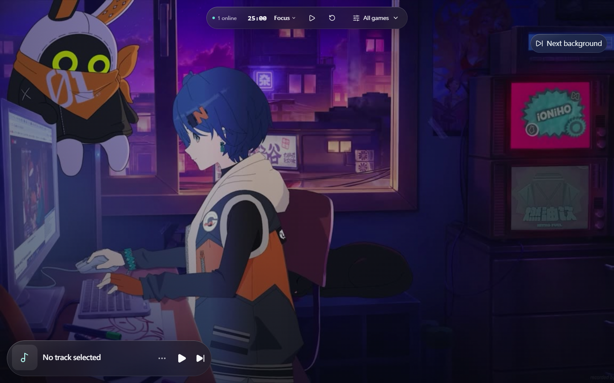
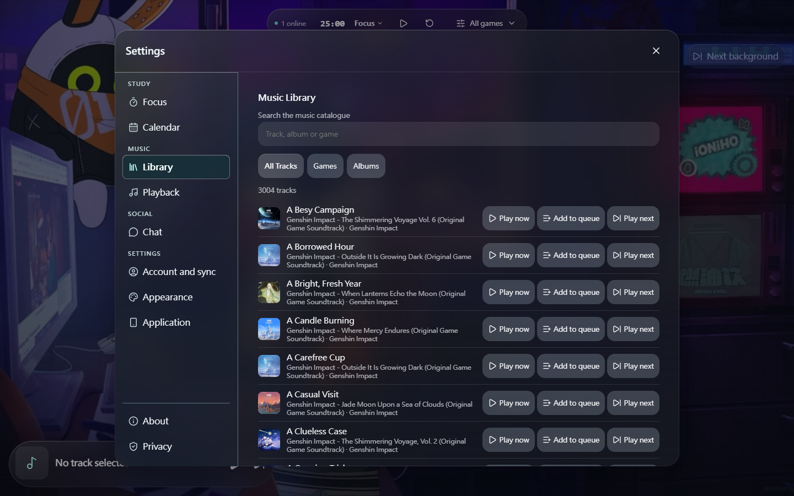
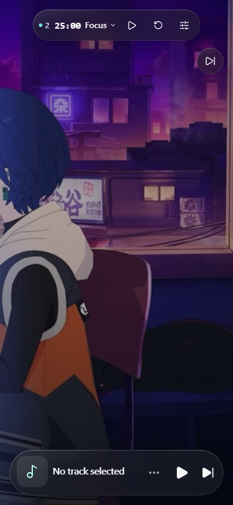
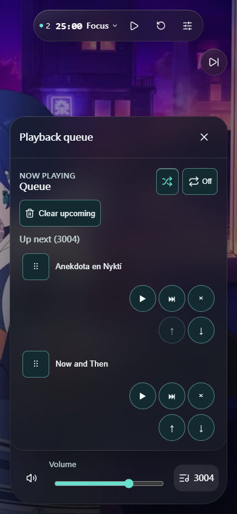

<div align="center">


# Study with HOYO-MiX

**An unofficial, non-commercial fan-made study & focus music workspace featuring HOYO-MiX soundtracks.**

<p align="center">
  <strong>English</strong> |
  <a href="./README.zh_CN.md">简体中文</a> |
  <a href="./README.zh_TW.md">繁體中文</a>
</p>

<p align="center">
  <a href="https://github.com/NullOkami47/study-with-hoyomix/actions/workflows/public-ci.yml"></a>
  <a href="LICENSE"></a>
  <a href="https://github.com/NullOkami47/study-with-hoyomix/commits/main"></a>
  <a href="https://github.com/NullOkami47/study-with-hoyomix/stargazers"></a>
  <a href="https://app.study-with-hoyomix.workers.dev"></a>
</p>

<p align="center">
  
  
  
  
</p>

<p align="center">
  <a href="#screenshots">Screenshots</a> •
  <a href="#capabilities">Capabilities</a> •
  <a href="#implemented">Implemented</a> •
  <a href="#new-functions-and-structure">New Functions</a> •
  <a href="#planned-features">Planned Features</a> •
  <a href="#tech-stack">Tech Stack</a> •
  <a href="#quick-start">Quick Start</a> •
  <a href="#continuous-integration">Continuous Integration</a> •
  <a href="#project-layout">Project Layout</a> •
  <a href="#credits">Credits</a> •
  <a href="#links">Links</a> •
  <a href="#license">License</a>
</p>

</div>

---

## 📝 Project Description

**Study with HOYO-MiX** ([`NullOkami47/study-with-hoyomix`](https://github.com/NullOkami47/study-with-hoyomix)) is the public open-source release of [`NullOkami47/hoyomix_web_player`](https://github.com/NullOkami47/hoyomix_web_player) — a calm, dark-mode study and focus web workspace built around a WebGPU / WebGL2 / CSS **Liquid Glass** interface, durable Pomodoro & sleep timers, multi-provider playback orchestration, anonymous-first local `IndexedDB` storage with optional OAuth cloud sync, and a Cloudflare Workers + D1 + R2 + Durable Objects edge backend.

The public production app is **[Study with HOYO-MiX](https://app.study-with-hoyomix.workers.dev)**, served by the Cloudflare Worker `app`.

This repository is a curated source distribution. The hosted app can run a different revision: the CI badge describes the public `main` branch, not the production deployment. Private operational records, deployment identities and unpublished release candidates are not included.

- [Build & Local Setup Guide (`BUILDING.txt`)](https://github.com/NullOkami47/study-with-hoyomix/blob/main/BUILDING.txt)
- [Source & Licence Notices (`NOTICE`)](https://github.com/NullOkami47/study-with-hoyomix/blob/main/NOTICE)
- [Third-Party Open-Source Notices (`docs/THIRD_PARTY_NOTICES.md`)](docs/THIRD_PARTY_NOTICES.md)

> [!IMPORTANT]
> **Unofficial Fan Project & Public Open-Source Distribution Notice**
>
> - **Unofficial & Non-Commercial**: Study with HOYO-MiX is an independent, fan-made, non-commercial study companion. It is **not** affiliated with, endorsed, sponsored, or approved by HoYoverse / miHoYo / Cognosphere or HOYO-MiX. Game titles, characters, and music trademarks belong to their respective rightsholders.
> - **Media & Credentials Excluded**: The public source release deliberately includes **no soundtrack library, copyrighted artwork, animated game wallpapers, user records, default third-party music-source scripts, or live service credentials**. Its shipped initial catalogue (`src/features/catalog/catalog.production.json` and `src/features/catalog/catalog.sample.json`) and static background definitions (`src/features/backgrounds/staticDefinitions.ts`) are empty by default so self-hosting operators can supply media and service credentials they are entitled to use.

> [!WARNING]
> **Third-Party Music Sources & External Services**
>
> Third-party music sources (including user's personal ChKSz API keys, and opt-in external resolvers) depend on external services outside this project's control. Endpoints may fail due to rate limits, regional restrictions, DNS/certificate errors, or upstream changes. Importing or enabling third-party sources is entirely at the user's own discretion and responsibility; please comply with local law, platform terms of service, and music copyright.

<a id="screenshots"></a>
<a id="en-screenshots"></a>

## 📸 Screenshots

### Desktop screenshots

| Main page | Music library |
| :---: | :---: |
|  |  |

### Mobile screenshots

| Main page | Playback queue |
| :---: | :---: |
|  |  |

<a id="capabilities"></a>
<a id="en-capabilities"></a>

## ⚡ Capabilities

| Area | What you can do |
| :--- | :--- |
| **Liquid Glass Workspace** | Study over a dual-slot crossfade video/poster backdrop (`1080p30` default, optional `1440p30` companion with automatic frame-drop fallback) rendered beneath a multi-pass WebGPU / WebGL2 optical refraction shader (`StudioGlassCanvas`, `LiquidGlassCanvas`) with resilient CSS fallback |
| **Durable Timers & Focus Logs** | Run monotonic-clock Pomodoro cycles (`focus`, `short-break`, `long-break`) with an optional break pause-lease for the player, configure a durable sleep timer (`15` / `30` / `45` / `60` / `90` min or custom), and review daily streaks in `StudyCalendar` |
| **Catalogue & Smart Queue** | Filter tracks by game (`genshin`, `hsr`, `zzz`), listening mode (`sleep`, `focus`, `chill`), and relation (`place`, `character`, `npc`, `faction`, `event`), search titles/aliases across Simplified & Traditional Chinese via `opencc-js`, and reorder a virtualised non-modal queue |
| **Multi-Provider Playback** | Resolve eligible tracks through the server-approved LX, GD Studio and ChKSz registry, with personal LX imports kept separate. Vkeys is an optional provider and remains disabled by default. Playback retains source fallback, MediaSession controls and diagnostics; legacy adapter files do not imply an active provider, and Jellyfin remains retired. |
| **QuickJS Custom Source Sandbox** | Import LX Music-compatible JavaScript sources and execute them inside an isolated Web Worker + `quickjs-emscripten-core` WebAssembly runtime (`src/features/player/lx/runtime/`) with strict memory, stack, timeout, and payload ceilings |
| **Local-First Library & OAuth Sync** | Persist favourites, custom playlists, recent playback history (opt-in, capped at 100 entries), and preferences in native `IndexedDB` / `localStorage`, or sign in with **Google**, **GitHub**, and **LINUX DO** to sync across devices via Cloudflare D1 |
| **Realtime Presence & Admin Console** | See live listener counts through `OnlinePresence` and community chat through the separate `ChatRoom` Durable Object. Manage catalogue revisions, Google Sheets imports, R2 background transcoding (`mediabunny` + WebCodecs), notices and provider health in `AdminShell`. |

<a id="implemented"></a>
<a id="en-implemented"></a>

## ✨ Implemented

#### Player, Queue & Quality Model

- **Compact & Expandable `PlayerBar`**: Single-row default with provenance-safe artwork, canonical track title, active provider badge, play/pause, and next; expands in-place to reveal seek bar, buffer progress, volume, queue trigger, source selector, and `PlaybackDiagnostics`.
- **Non-Modal Resizable `QueuePanel`**: Retains `Shuffle` and `Repeat` states in the header, renders `Previously Played` above a fixed `Now Playing` row, virtualises `Up Next` for long queues, and supports 44 px pointer/keyboard reordering plus desktop width/height resizing.
- **Sheet Suspension Invariant**: Opening modal sheets (`SettingsSheet`, `LibrarySheet`, `ControlCentre`) cleanly suspends active official YouTube IFrame media and restores playback intent on close without layout shift or duplicate resume events.
- **Quality Selection (`src/features/player/qualityPreferences.ts`)**:
  - **ChKSz tiers (`src/shared/chksz.ts`)**: `standard`, `exhigh`, `lossless`, `hires`, `jyeffect`, `sky`, `jymaster`.
  - **LX tiers**: `standard`, `high`, `lossless`, `hires`.
  - Unavailable target tiers degrade gracefully to playable resources while reporting the actual resolved quality metadata.

#### Third-Party Music Sources & Security Boundaries

- **Local Consent Gate**: Third-party resolvers (`chksz`, `lx-user`, etc.) require explicit local user agreement (`ThirdPartyAgreement.vue`) and can be toggled in Settings.
- **QuickJS WASM Runtime (`src/features/player/lx/runtime/`)**: Executes user scripts inside a dedicated module Worker using `quickjs-emscripten-core` and `@jitl/quickjs-wasmfile-release-asyncify` (`0.32.0`), enforcing deterministic memory, stack, call-timeout, and bridged-response limits defined in `protocol.ts`.
- **ChKSz Personal Credential Support**: Supports user-supplied `chksz_` API keys (registered via `api.chksz.com` with a LinuxDo account) alongside Worker-side SSRF/origin validation (`src/shared/chksz.ts`).

## New functions and structure

This source tree includes the development release work described below, with empty catalogue defaults and synthetic test inputs. The combined release is **awaiting final verification**. Publication and production activation require their own review and approval. Features that depend on configured providers, qualified catalogue data or optional automation remain subject to those requirements.

| Area | New behaviour in the release candidate |
| :--- | :--- |
| **Background playback and recovery** | Keeps a stable active audio element through natural track handoff on Android, rejects stale preparation/recovery replies, and preserves explicit Play, Pause, Seek, Next and Previous intent. Apple mobile WebKit avoids the zero-volume preroll that caused incorrect media timing. Source failures use bounded recovery; Pause, Stop and sleep expiry must not be undone by late replies. |
| **Track preparation and transitions** | Prepares the next track through the enabled provider fallback chain. Adds **Off**, **Smooth Crossfade** and **Smart Mix** settings; Off remains the default. Transition duration defaults to 5 seconds and can be set from 2–12 seconds. Overlap requires ready media and supported volume control, and cancels on interruption, seeking, backgrounding or stale ownership. Smart Mix analyses existing playback with a deterministic fallback. |
| **Provider resilience and artwork** | GD Studio can reconcile a mismatched audio MIME label against a recognised container header while retaining URL, redirect, Range and media-ticket validation. Library artwork uses current LX/GD and applicable legacy fallback sources instead of an automatic dependency on the retired Jellyfin service. |
| **Optional Vkeys QQ Music adapter** | Adds a distinct QQ Music provider with identity matching, media qualification and expiry/recovery handling. It is **disabled by default**. Qualification currently covers MP3 samples; this is not a claim of universal format, region or device support. NetEase playback through this adapter and InnerTube playback were investigated but are not integrated. |
| **Global LX source management** | Adds an owner-managed registry with immutable script snapshots and content hashes, update/rollback by version, and explicit network-origin approval. Personal imported sources remain separate. Scripts continue to execute inside the bounded QuickJS sandbox. |
| **Community chat and presence** | Separates chat protocol, storage, moderation and retention into dedicated Worker modules, with responsive and floating chat views, authenticated sending and request deduplication. Presence remains a separate service boundary. |
| **Workspace polish** | Refines Focus glass surfaces, library artwork fallback and focus-record presentation alongside the playback work. |
| **Catalogue discovery and review** | Adds deterministic discovery for Genshin Impact, Honkai: Star Rail and Zenless Zone Zero, an Admin discovery inbox, source/identity checks, classification suggestions and a Google Sheets staging/review flow. Canonical track identity remains separate from provider IDs; candidates without a qualified playable source remain candidates rather than silently entering the catalogue. Focus eligibility is independent of whether a track has vocals. |
| **Optional catalogue automation** | Adds durable row/cycle/staging records for a bounded discover → classify → stage → publish round trip. Automatic processing and automatic publication are separate opt-ins, both **off by default**. Publication rechecks source identity, reviewed changes, catalogue revision and write-budget evidence; uncertain outcomes require reconciliation. No personal AI account or external schedule is implicitly connected. |

The new work is organised around the following module boundaries in this candidate source tree:

| Module or directory | Responsibility |
| :--- | :--- |
| `src/features/player/PlayerBar.vue`, `store.ts`, `preloadPolicy.ts` | Native audio lifecycle, explicit user intent, provider resolution and freshness checks for the prepared next track. |
| `src/features/player/transitionEngine.ts` | Transition modes, overlap timing, envelopes and cancellation rules. |
| `src/features/player/providers/vkeys.ts` and `workers/providers/vkeys*.ts` | Client adapter plus server-side identity, media and response-policy checks for the optional provider. |
| `workers/lx/` and `src/features/player/lx/globalSourceRepository.ts` | Shared source registry, immutable snapshots, client cache and network-origin approval. |
| `workers/chat/`, `workers/presence.ts` and `src/features/chat/` | Chat routing/protocol, persistence, retention/moderation, presence and responsive views. |
| `workers/catalogue/discovery/scanner.ts` | Bounded official-feed discovery and validated candidate manifests. |
| `src/features/admin/CatalogueDiscovery.vue` | Review inbox, classification and staging controls. |
| `workers/catalogue/discovery/` | Candidate storage, source qualification, Sheets reconciliation, staging and optional automation/publication. |
| `migrations/0029_community_chat.sql`–`0031_lx_global_sources.sql` | Chat sending/retention records and the shared LX source registry. |
| `migrations/0032_catalogue_discovery.sql` and `0033_catalogue_discovery_automation.sql` | Additive discovery and automation ledgers. Schema preparation does not activate automation. |

Release qualification still includes complete source-bound CI and physical-device checks for background transitions, source recovery, manual controls, sleep shutdown, crossfade and installed PWAs. A normal browser run or passing unit tests does not establish all of those behaviours. Public-source synchronisation and production activation are separate reviewed steps.

<a id="planned-features"></a>
<a id="en-planned-features"></a>

## Planned work

- Complete release qualification and the reviewed public-source update for the implemented changes above.
- Expand the catalogue, including eligible fan-made arrangements, after source and redistribution-rights review.
- Improve Liquid Glass rendering, surface depth and visual polish.
- Explore Zenless Zone Zero TV/CRT, Genshin Impact and Honkai: Star Rail interface themes.
- Qualify additional music providers and formats before enabling them.

<a id="tech-stack"></a>
<a id="en-tech-stack"></a>

## 🛠️ Tech Stack

| Layer | Implementation |
| :--- | :--- |
| **UI & Reactivity** | Vue 3.5 (Composition API, `<script setup>`), `@vueuse/core`, TypeScript 5.6, Vite 8.3 |
| **Glass & Styling** | Custom CSS Design Tokens (`src/styles/tokens.css`), Multi-Pass WebGPU / WebGL2 Shaders (`src/features/liquid-glass/`), Lucide Vue Next |
| **Playback & Media** | `HTMLAudioElement`, Official YouTube IFrame Player API, MediaSession API, `mediabunny` 1.61.1 (WebCodecs MP4 inspection & transcode) |
| **Custom Source Sandbox** | Web Worker + QuickJS WebAssembly (`quickjs-emscripten-core` & `@jitl/quickjs-wasmfile-release-asyncify` `0.32.0`) |
| **Search & Localisation** | Trilingual i18n (`en`, `zh-Hans`, `zh-Hant`), `opencc-js` 1.4.2 + precomputed CJK Han-folding (`src/features/catalog/hanFold.ts`) |
| **Local Persistence** | Native browser `IndexedDB` (`src/features/library/localRepository.ts`, `src/features/focus/localRepository.ts`), `localStorage` (`src/utils/safeStorage.ts`), PWA (`vite-plugin-pwa`) |
| **Edge Backend & Storage** | Cloudflare Workers (`workers/index.ts`), separate presence/chat Durable Objects (`workers/presence.ts`, `workers/chat/ChatRoom.ts`), Cloudflare D1 (SQLite) and Cloudflare R2 |
| **Authentication & Security** | OAuth 2.0 / OIDC (Google, GitHub, LINUX DO), HMAC-SHA256 Session Cookies & Media Tickets, Strict Origin / CSRF / SSRF Guards |
| **Testing & Tooling** | Vitest, `@vue/test-utils`, `fake-indexeddb`, `jsdom`, Miniflare, Wrangler 4 |

<a id="quick-start"></a>
<a id="en-quick-start"></a>

## 🚀 Quick Start

#### 1. Prerequisites

- **Node.js** `22.18.0` or newer; public CI verifies the Node.js 22 line
- **npm** (bundled with Node.js)
- **Git**

#### 2. Install & Run Frontend Development

```bash
# Install exact locked dependencies from package-lock.json
npm ci

# Start the local Vite development server (automatically decodes PWA icons & generates build info)
npm run dev
```

Common verification and build scripts:

```bash
npm run typecheck     # Generate build info and run vue-tsc + tsc type checking
npm test              # Run frontend unit and component tests via Vitest
npm run test:workers  # Run Cloudflare Worker + D1 integration tests via Miniflare/Vitest
npm run test:lx-policy-native # Run bounded LX publication/revocation regressions on Node 22
npm run build         # Decode PWA icons, generate build info, and build production bundle into dist/
npm run preview       # Preview the built frontend locally
npm run verify        # Run typecheck, frontend tests, Worker tests, and production build
```

Production and staging builds require explicit response-policy inputs in the build process environment. Set `RESPONSE_POLICY_PUBLIC_ORIGIN` to your HTTPS site origin, `RESPONSE_POLICY_R2_BASE_URL` to your authorised HTTPS media base URL, and `LX_ALLOWED_ORIGINS` to the origins your enabled LX sources require (or an empty string). Missing or invalid release inputs fail the build; local operator files are not read automatically.

For compilation checks without live services, use non-resolving fixture origins:

```powershell
$env:RESPONSE_POLICY_PUBLIC_ORIGIN = 'https://public-ci.example.invalid'
$env:RESPONSE_POLICY_R2_BASE_URL = 'https://media.public-ci.example.invalid/'
$env:LX_ALLOWED_ORIGINS = ''
npm run build
```

Public CI uses these inputs only for its build step. This verifies compilation and response-policy generation; it does not deploy a usable media service or establish production configuration. Replace the fixture values with your own reviewed settings before a real deployment.

#### 3. Local Sign-In Button Preview (`HOYOMIX_DEV_AUTH_PREVIEW`)

Normal `npm run dev` leaves authentication requests to the downstream backend. To preview all three sign-in buttons (`Google`, `GitHub`, `LINUX DO`) without authenticating, explicitly set `HOYOMIX_DEV_AUTH_PREVIEW=1` in the development server's process environment:

```powershell
$env:HOYOMIX_DEV_AUTH_PREVIEW = '1'
try { npm run dev } finally { Remove-Item Env:HOYOMIX_DEV_AUTH_PREVIEW }
```

```sh
HOYOMIX_DEV_AUTH_PREVIEW=1 npm run dev
```

Only the exact value `1` enables this mock; absent, `0`, and `true` leave it off. Do not add it to checked-in environment files; Vite `.env` files do not enable it. It applies only to the Vite development server in `development` mode, never production or staging builds, deployed environments, or `npm run preview`, even when the flag is set.

The mock handles only exact `GET /api/auth/providers` (three available providers), `GET /api/session` (signed-out `401`), and `GET /api/auth/{google,github,linuxdo}/start` (plain-text `501` stating OAuth did not occur). Query strings, including identity-linking queries, are accepted. Responses carry `X-Hoyomix-Dev-Auth-Mock: 1`; JSON responses also contain `mock: true`. Starts do not redirect, create cookies or tokens, sign in, or link identities. Other methods and routes, including trailing slashes and callbacks, continue downstream.

#### 4. Recreate the PWA Icons

The install icons are stored in Git as text-only Base64 sources (`scripts/pwa-icons/pwa-icon-192.png.base64.txt` and `scripts/pwa-icons/pwa-icon-512.png.base64.txt`) so code-review systems that reject binary patches can still carry the complete PWA change. The generated PNG files are intentionally ignored.

Run the decoder directly when you need the raster files:

```bash
node scripts/generate-pwa-icons.mjs
```

`npm run dev` and `npm run build` run the decoder automatically. The decoder validates the Base64 syntax, PNG signature, declared dimensions, and SHA-256 digest before writing `public/pwa-icon-192.png` and `public/pwa-icon-512.png`.

#### 5. Complete Local Worker + D1 Backend Environment

To run the complete local Cloudflare Worker + frontend environment:

1. Copy `.dev.vars.example` to `.dev.vars` (ignored by Git).
2. Generate independent `SESSION_HMAC_SECRET` and `OAUTH_STATE_SECRET` values in `.dev.vars`, each at least 32 random bytes. Never use client-side `VITE_` variables for secrets.
3. Optional OAuth & Owner bootstrap: configure provider credentials (`GOOGLE_*`, `GITHUB_*`, `LINUXDO_*`) in `workers/auth/types.ts` / `workers/index.ts` and explicit owner identity via `OWNER_PROVIDER` and `OWNER_SUBJECT`, or leave them unset to keep sign-in providers disabled.
4. Initialise the local D1 database, build the frontend, and start Wrangler:

```bash
npm run d1:migrate:local
npm run build
npm run dev:worker
```

Open `http://localhost:8787`. The checked-in `wrangler.toml` identifies local resources only.

#### 6. Supplying Your Own Media (Open-Source Release)

Because the public release deliberately ships with an empty catalogue and background list:

- **Music Catalogue**: Populate `src/features/catalog/catalog.production.json` (and `catalog.sample.json`) conforming to `src/features/catalog/schema.ts`, or administer catalogue revisions and optional Google Sheets imports through `workers/catalogue/`. To regenerate the optional Han folding table after adding catalogue text, run `node scripts/generate-han-fold-table.mjs`.
- **Music Providers**: Configure opt-in server-side providers in `src/features/player/providers/registry.ts`, `workers/providers/routing.ts`, `workers/providers/config.ts`, and `workers/index.ts` with your own authorised R2 or supported resolver resources. Jellyfin is retired from the hosted service; legacy source references do not imply an active service.
- **Background Stage**: To add redistributable static backgrounds, update `src/features/backgrounds/staticDefinitions.ts` and place the referenced files under `public/`. Uploaded dynamic backgrounds require an explicitly configured `BACKGROUND_BUCKET` R2 binding.

## Continuous integration

[Public CI](https://github.com/NullOkami47/study-with-hoyomix/actions/workflows/public-ci.yml) runs for pull requests into `main`, pushes to `main`, and manual dispatch. It uses standard GitHub-hosted Ubuntu 24.04 runners and Node.js 22.

The workflow installs the public lockfile, checks types, runs the complete public frontend and Worker test suites, builds the app, applies migrations to an ephemeral local D1 database, and checks production dependencies for high or critical vulnerabilities. Frontend tests retain their existing three-worker limit; Worker tests use two workers. The jobs request read-only repository access and use no deployment secrets, self-hosted runner, dependency cache or uploaded artifact.

The job summary records the tested commit/tree, tool versions and input hashes before the build. `All public checks` passes only when validation succeeds; failed, cancelled or skipped validation is rejected. See [the CI guide](docs/public-ci.md) for exact commands, action pins and the result gate.

To run the application checks locally:

```sh
npm ci
npm run verify
npm run d1:migrate:local
npm audit --omit=dev --audit-level=high
```

These checks cover the source and synthetic fixtures published here. They do not demonstrate live provider availability, audible background playback on physical devices, production readiness, or equivalence with an unpublished candidate. The supplied catalogue and background definitions remain empty by default.

<a id="project-layout"></a>
<a id="en-project-layout"></a>

## 📁 Project Layout

```text
study-with-hoyomix/
├── .github/workflows/public-ci.yml # Public hosted validation and success gate
├── docs/
│   ├── licenses/                 # MIT, Apache-2.0 & runtime dependency licence texts
│   └── THIRD_PARTY_NOTICES.md    # Upstream & third-party attribution notices
├── migrations/                   # D1 schema, chat/LX and discovery ledgers through 0033
├── public/                       # PWA manifests, robots.txt, SVG icon & title cache helper
├── scripts/
│   ├── pwa-icons/                # Base64-encoded 192px & 512px PNG icon sources
│   ├── generate-build-info.mjs   # Build metadata generator
│   ├── generate-han-fold-table.mjs # OpenCC CJK search-folding table generator
│   ├── generate-pwa-icons.mjs    # Verified Base64-to-PNG icon decoder
│   └── public-notices.ts         # Vite plugin serving /legal/*.txt notices
├── src/
│   ├── components/shell/         # Accessible AppShell landmark & skip-link frame
│   ├── features/
│   │   ├── account/              # OAuth session, identity linking & D1 preference/library sync
│   │   ├── admin/                # AdminShell, catalogue/background/notice/provider managers
│   │   ├── backgrounds/          # Dual-slot video/poster store, overrides & staticDefinitions.ts
│   │   ├── catalog/              # Schema validation, multi-dimensional filters, OpenCC & Han fold
│   │   ├── chat/                 # FloatingChatWindow & safe-dock layout geometry
│   │   ├── focus/                # Pomodoro recorder, StudyCalendar & local/remote repositories
│   │   ├── legal/                # FanProjectNotice store & component
│   │   ├── library/              # MusicLibrary, AlbumCard, IndexedDB repository & merge dialog
│   │   ├── liquid-glass/         # WebGPU/WebGL2 multi-pass shaders, StudioGlassCanvas & NOTICE.md
│   │   ├── notices/              # System NoticeCentre & NoticeHistory
│   │   ├── player/               # PlayerBar, QueuePanel, QuickJS LX sandbox & provider adapters
│   │   ├── settings/             # Unified 8-section SettingsSheet, LxSourceManager & agreements
│   │   ├── timers/               # Durable monotonic-clock Pomodoro & SleepTimer stores
│   │   └── workspace/            # StudyWorkspace root, FocusBar, ControlCentre, SceneBackdrop
│   ├── i18n/                     # Trilingual messages (en, zh-Hans, zh-Hant)
│   ├── pwa/                      # Service worker registration, install & update status
│   ├── shared/                   # Shared ChKSz validation, matcher & version signature logic
│   ├── stores/                   # Workspace preferences store
│   ├── styles/                   # Liquid Glass CSS custom properties (tokens.css)
│   ├── test/                     # Frontend unit, attribution, runtime & Vite config specs
│   ├── types/                    # TypeScript environment declarations
│   └── utils/                    # Safe storage wrapper
├── tests/fixtures/               # Tiny synthetic MP4 & poster fixtures for video validation tests
├── workers/
│   ├── account/                  # User preference sync handlers
│   ├── admin/                    # Role-gated admin API routes & authorization
│   ├── auth/                     # Google, GitHub & LINUX DO OAuth/OIDC flows & session signing
│   ├── backgrounds/              # R2 background media & MP4 bitstream validation routes
│   ├── catalogue/                # Catalogue discovery/review, Sheets, staging & guarded publication
│   ├── focus/                    # Focus session sync routes
│   ├── library/                  # Cloud library sync routes
│   ├── lx/                       # Owner-managed source registry, snapshots & public source policy
│   ├── providers/                # Server-side audio provider config, SSRF guards & routes
│   ├── test/                     # Miniflare Worker + D1 security & integration test suites
│   ├── index.ts                  # Main Cloudflare Worker fetch & scheduled handler
│   ├── chat/                     # ChatRoom protocol, storage, moderation & retention
│   └── presence.ts               # OnlinePresence Durable Object and presence routing
├── BUILDING.txt                  # Local development and Worker setup instructions
├── LICENSE                       # GNU General Public License v3.0
├── NOTICE                        # Source, modification & copyright notices
└── wrangler.toml                 # Local Cloudflare Workers, D1, R2 & Durable Objects config
```

<a id="credits"></a>
<a id="en-credits"></a>

## 🙏 Credits

The public edition contains the incorporated components listed below. Research references informed design or evaluation work; they are not claims of bundled dependencies, shipped candidate features, live-service availability or device acceptance.

### Incorporated foundations and renderer components

- [shshouse/StudyWithMiku](https://github.com/shshouse/StudyWithMiku) — the application baseline from which this project was adapted; retained notices are in [NOTICE](NOTICE) and [third-party notices](docs/THIRD_PARTY_NOTICES.md).
- [iyinchao/liquid-glass-studio](https://github.com/iyinchao/liquid-glass-studio) — selected renderer and shader components adapted under MIT; retained notices and source mapping are in [the renderer notice](src/features/liquid-glass/NOTICE.md).

### Upstream acknowledgements and compatibility references

- [DIYgod/APlayer](https://github.com/DIYgod/APlayer) — acknowledged by the original StudyWithMiku project; its legacy bundles are not included in this public source edition.
- [metowolf/Meting](https://github.com/metowolf/Meting) — API/compatibility research reference. The separate @meting/core-based compatibility service is not included in this public source edition.

### Design, architecture and platform research

- [gxxk-dev/StudyWithMiku](https://github.com/gxxk-dev/StudyWithMiku) — reference for Focus records, sessions and PWA design; the local implementation follows its own storage and update model.
- [WenqiOfficial/StudyWithMiku](https://github.com/WenqiOfficial/StudyWithMiku) — update-strategy research reference; its polling/update implementation was not incorporated.
- [pdone/lx-music-source](https://github.com/pdone/lx-music-source) — protocol research for independently implemented LX resolver adapters; upstream scripts were not copied wholesale.
- [guoyue2010/lxmusic-](https://github.com/guoyue2010/lxmusic-) — historical source-provenance research using dated LX mirror snapshots; not a bundled runtime dependency.
- [lladlam/MeloX-Android](https://github.com/lladlam/MeloX-Android) — reference for third-party music-source disclosure and consent topics; its branding and cloud-control architecture were not adopted.
- [jizizr/mhub](https://github.com/jizizr/mhub) — research reference for multi-provider resolution, media validation and playback qualification; its code is not vendored or added as a dependency.
- [qier222/YesPlayMusic](https://github.com/qier222/YesPlayMusic) — NetEase resolver and player-architecture feasibility reference; no application code was incorporated.
- [metowolf/MetingJS](https://github.com/metowolf/MetingJS) — browser-player integration research reference; not incorporated into the Worker-only provider architecture.
- [NeteaseCloudMusicApiEnhanced/api-enhanced](https://github.com/NeteaseCloudMusicApiEnhanced/api-enhanced) — resolver API feasibility research; not shipped as a provider or dependency in this public edition.
- [sxhxliang/gpui-liquid-glass](https://github.com/sxhxliang/gpui-liquid-glass) — design reference for backdrop ownership, layering, lifecycle cleanup and readable fallbacks; native code was not ported.
- [lucaperullo/simple-liquid-glass](https://github.com/lucaperullo/simple-liquid-glass) — evaluated renderer/Web Component alternative that informed CSP and backdrop-ownership decisions; no source was incorporated.
- [gentpan/liquidglass](https://github.com/gentpan/liquidglass) — source-review reference for refraction and fallback approaches; no source was incorporated.
- [regosen/Gapless-5](https://github.com/regosen/Gapless-5) — research reference for preload readiness, fade envelopes and cleanup; not a runtime dependency.
- [subframe7536/audio0](https://github.com/subframe7536/audio0) — research reference for queue-aware preparation, listener cleanup and Media Session lifecycle; not a runtime dependency.
- [goldfire/howler.js](https://github.com/goldfire/howler.js) — research reference for media fallback, pooling/unlock and fade cancellation; not a runtime dependency.
- [meyda/meyda](https://github.com/meyda/meyda) — research reference for bounded audio-feature sampling; no Meyda dependency or FFT/BPM pipeline was added.
- [monochrome-music/monochrome](https://github.com/monochrome-music/monochrome) — reference for guarded synchronous handoff on the existing audio element; in particular [PR #558](https://github.com/monochrome-music/monochrome/pull/558), studied during background-playback work. It was not vendored or treated as device-acceptance proof.
- [phiamo/capacitor-plugin-playlist](https://github.com/phiamo/capacitor-plugin-playlist) — native playlist and background-audio feasibility reference; no plugin or native application was integrated.
- [androidx/media](https://github.com/androidx/media) — platform research for MediaSessionService and native background-audio lifecycle; not a dependency of this web app.
- [WebKit/WebKit](https://github.com/WebKit/WebKit) — source and behaviour research on background media, volume handling and platform limits; no WebKit code was incorporated.
- [TeamPiped/Piped-Backend](https://github.com/TeamPiped/Piped-Backend), [OpenAPI](https://github.com/TeamPiped/OpenAPI) and [documentation](https://github.com/TeamPiped/documentation) — API schema and stream-response research for the independent provider adapter; the Piped frontend and backend are not bundled.
- [iv-org/invidious](https://github.com/iv-org/invidious) — API and audio-stream contract research for an independently implemented bounded provider adapter; server code was not bundled.

### Historical development tooling

- [yt-dlp/yt-dlp](https://github.com/yt-dlp/yt-dlp) — historical media-preparation metadata tooling recorded in earlier work; not bundled with this public source edition.


The actual browser sandbox dependency is [justjake/quickjs-emscripten](https://github.com/justjake/quickjs-emscripten). Other shipped dependency notices, including Mediabunny and OpenCC, are maintained in [third-party notices](docs/THIRD_PARTY_NOTICES.md) and the retained licence texts.

These acknowledgements record the role established by source and research records. Similar project names or a link appearing inside another project do not by themselves establish use.

<a id="links"></a>
<a id="en-links"></a>

## 🔗 Links

- [LINUX DO](https://linux.do/)

<a id="license"></a>
<a id="en-license"></a>

## 📄 License & Attribution

The implementation baseline is derived from [StudyWithMiku](https://github.com/shshouse/StudyWithMiku) at commit [`7b094632d08a6599a1b334e6c6af41dc10ea6495`](https://github.com/shshouse/StudyWithMiku/tree/7b094632d08a6599a1b334e6c6af41dc10ea6495). Study with HOYO-MiX is licensed under **GPL-3.0**; see [LICENSE](LICENSE), [NOTICE](https://github.com/NullOkami47/study-with-hoyomix/blob/main/NOTICE), and [third-party notices](docs/THIRD_PARTY_NOTICES.md).

The post-MVP LLM classification system is intentionally separated from the MVP plans. No upstream media is included until its provenance is independently verified and recorded.
