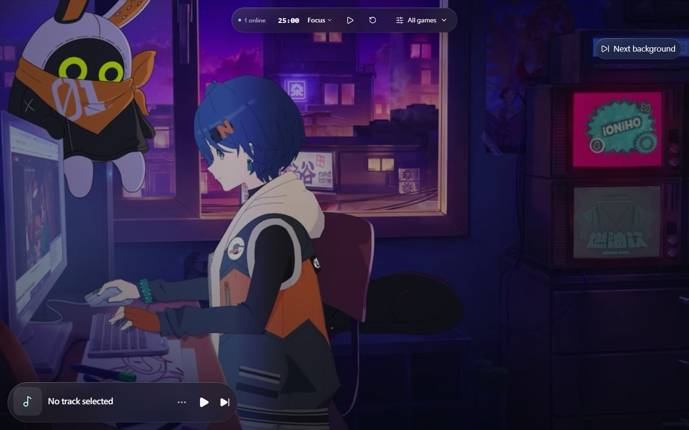
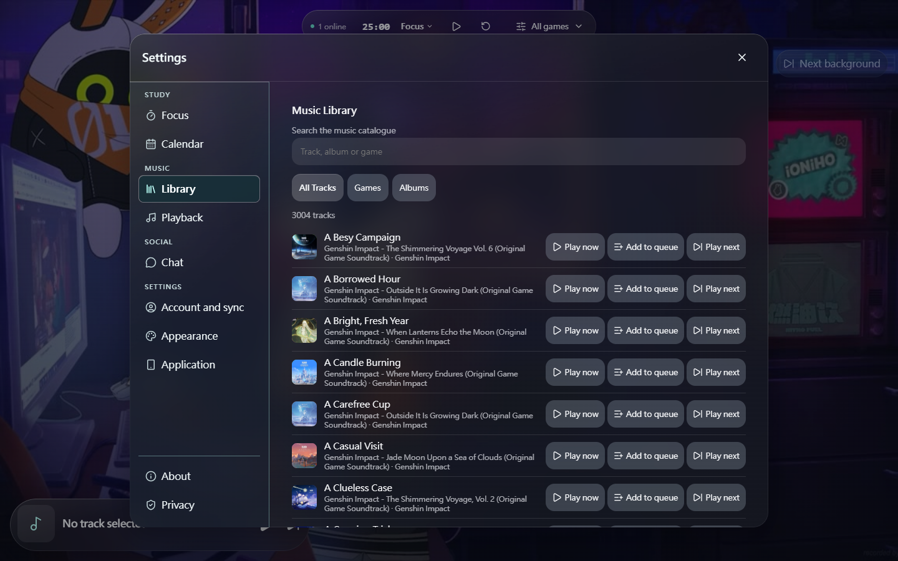
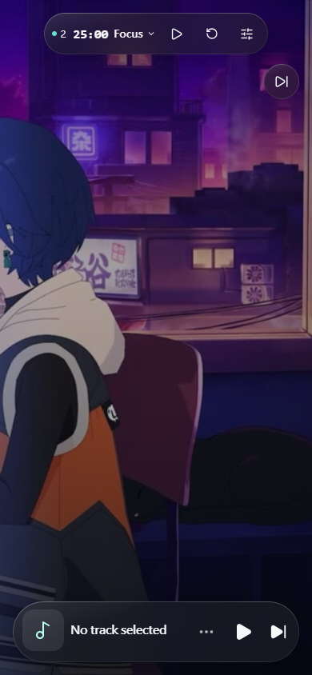
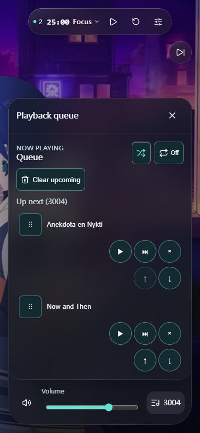

<div align="center">


# Study with HOYO-MiX

**一个以 HOYO-MiX 音乐陪伴学习的非官方粉丝项目。**

<p align="center">
  <a href="./README.md">English</a> |
  <strong>简体中文</strong> |
  <a href="./README.zh_TW.md">繁體中文</a>
</p>

<p align="center">
  <a href="https://github.com/NullOkami47/study-with-hoyomix/actions/workflows/public-ci.yml"></a>
  <a href="LICENSE"></a>
  <a href="https://github.com/NullOkami47/study-with-hoyomix/commits/main"></a>
  <a href="https://github.com/NullOkami47/study-with-hoyomix/stargazers"></a>
  <a href="https://app.study-with-hoyomix.workers.dev"></a>
</p>

<p align="center">
  
  
  
  
</p>

<p align="center">
  <a href="#screenshots">界面预览</a> •
  <a href="#capabilities">核心能力</a> •
  <a href="#implemented">已实现功能</a> •
  <a href="#architecture-and-modules">架构说明</a> •
  <a href="#planned-features">未来计划</a> •
  <a href="#tech-stack">技术栈</a> •
  <a href="#quick-start">快速开始</a> •
  <a href="#project-layout">目录结构</a> •
  <a href="#credits">致谢</a> •
  <a href="#links">友链</a> •
  <a href="#license">开源协议</a>
</p>

</div>

---

## 📝 项目简介

**Study with HOYO-MiX**（[`NullOkami47/study-with-hoyomix`](https://github.com/NullOkami47/study-with-hoyomix)）是一个以 **HOYO-MiX** 游戏原声音乐陪伴学习与专注的非官方深色系 Web 工作台。项目围绕 WebGPU / WebGL2 / 预烘焙贴图 / CSS **Liquid Glass（液态玻璃）** 光学材质打造，内置持久化番茄钟与睡眠定时器、支持预加载与过渡混音的多音源播放引擎、基于原生 `IndexedDB` 的匿名本地优先曲库与可选 OAuth 云同步、实时社区聊天室，以及基于 Cloudflare Workers + D1 + R2 + Durable Objects 的边缘后端架构。

公开生产环境应用部署于 **[Study with HOYO-MiX](https://app.study-with-hoyomix.workers.dev)**，由 Cloudflare Worker `app` 提供服务。

本仓库为公开开源发行版本，不包含任何私有运维脚本、部署密钥或受版权保护的音视频曲库。

- [系统架构说明 (`docs/architecture.md`)](docs/architecture.md)
- [更新日志 (`CHANGELOG.md`)](CHANGELOG.md)
- [构建与自托管指南 (`BUILDING.txt`)](BUILDING.txt)
- [源码与开源许可声明 (`NOTICE`)](NOTICE)
- [第三方开源声明 (`docs/THIRD_PARTY_NOTICES.md`)](docs/THIRD_PARTY_NOTICES.md)

> [!IMPORTANT]
> **非官方粉丝项目与公开开源发行声明**
>
> - **非官方与非商业性质**：Study with HOYO-MiX 是一个独立的、非商业性质的粉丝自制学习陪伴项目，与米哈游（HoYoverse / miHoYo / Cognosphere）或 HOYO-MiX **不存在任何隶属、背书、赞助或授权关系**。相关游戏名称、角色与音乐商标均归其各自权利人所有。
> - **不含受版权保护的媒体与线上凭据**：本公开开源发行版**刻意不包含任何原声音乐曲库、受版权保护的游戏美术封面、动态游戏壁纸、用户数据、默认第三方音源脚本或线上服务密钥**。初始曲库（`catalog.production.json`、`catalog.sample.json`、`public/catalogue/v1.json`）与静态背景定义（`staticDefinitions.ts`）默认为空，供自托管部署者自行配置拥有合法使用权的资源。

> [!WARNING]
> **第三方音乐源与外部服务免责声明**
>
> 第三方音乐源（包括用户个人 ChKSz API Key、自定义/全局 LX 脚本及可选外部解析服务）均依赖非本项目控制的外部服务，可能因限流、地区限制、证书错误或上游变更而失效。请遵守当地法律法规、平台服务条款与音乐版权规范。

<a id="screenshots"></a>
<a id="zh-cn-screenshots"></a>

## 📸 界面预览

### 桌面版截图

| 主页 | 音乐库 |
| :---: | :---: |
|  |  |

### 手机版截图

| 主页 | 播放队列 |
| :---: | :---: |
|  |  |

<a id="capabilities"></a>
<a id="zh-cn-capabilities"></a>

## ⚡ 核心能力

| 模块领域 | 功能说明 |
| :--- | :--- |
| **液态玻璃工作台** | 双槽位无缝交叉淡入淡出背景舞台（`SceneBackdrop`），结合 WebGPU / WebGL2 多通道光学折射着色器（`StudioGlassCanvas`、`LiquidGlassCanvas`、`AdaptiveGlassSurface`）、预烘焙折射纹理与遵循系统透明偏好的 CSS 降级方案 |
| **持久化计时与学习统计** | 基于单调时钟的番茄工作法计时器（`focus`、`short-break`、`long-break`，支持休息暂停音乐租约）、持久化睡眠定时器（`15` / `30` / `45` / `60` / `90` 分钟与自定义倒计时）及 `StudyCalendar` 学习打卡统计 |
| **Vocal 分类、多维曲库与虚拟队列** | 支持按游戏（`genshin`、`hsr`、`zzz`）、模式（`sleep`、`focus`、`chill` 与独立的 Vocal/人声分类筛选）和关联实体筛选，`opencc-js` 简繁共通检索，以及支持随机（Shuffle）与循环（`off`/`all`/`one`）的可调尺寸虚拟滚动队列 |
| **多音源播放、过渡与统一恢复** | 协调现行活跃音源（`chksz`、`lx`、`gd-studio`；Jellyfin 与 Vkeys 已退役），提供 `requestSourceRecovery` 统一恢复链（10 秒冷却期内同源票据续期后顺延回退）、下一曲预加载、**无过渡 / 平滑淡入淡出 / Smart Mix 智能混音**（2–12 秒）、专辑封面本地缓存、移动端后台交接优化与 `PlaybackDiagnostics` |
| **QuickJS 自定义与全局 LX 源** | 在独立 Web Worker + `quickjs-emscripten-core` WebAssembly 沙箱中执行个人或管理员发布的全局 LX 脚本，结合 Worker 端 `acorn` 词法元数据校验、内容哈希与显式 `LX_ALLOWED_ORIGINS` CSP 策略 |
| **本地优先曲库与云同步** | 免登录即可通过 `IndexedDB` 与 `localStorage` 保存收藏、自建歌单与可选播放历史（最多 100 条）；支持通过 **Google**、**GitHub**、**LINUX DO** 登录并同步至 Cloudflare D1 |
| **社区聊天室与管理后台** | 基于 `ChatRoom` SQLite Durable Object 与 D1 的实时自习聊天室（编辑/回复、表情贴纸、屏蔽与举报、受限正则屏蔽词过滤、版主审核与保留恢复机制），配合 `OnlinePresence` 在线人数统计及权限隔离的 `AdminShell`（曲库版本与发现入库、Google Sheets 导入、R2 视频转码、全站公告、音源健康度与排序） |

<a id="implemented"></a>
<a id="zh-cn-implemented"></a>

## ✨ 已实现功能与架构边界

- **现行与退役/兼容音源**：公开版本默认仅在播放链中注册现行规范音源 `chksz`、`lx`、`gd-studio` 并提供服务端 SSRF/媒体票据/容器头校验。**Jellyfin** 与 **Vkeys** 已完全退役（不参与配置与偏好且管理路由返回 `404`）；旧版 `r2`/`meting`/`piped`/`invidious`/`qijie`/`lx-huanyin`/`lx-huibq`/`lx-ikun` 等标识未在默认前端运行时启用，仅在未显式配置时保持禁用状态，并保留服务端安全契约测试、历史曲目校验及曲库发现（`workers/catalogue/discovery/`）兼容层。
- **社区聊天室与在线状态**：采用独立的 `ChatRoom` SQLite Durable Object 与 `OnlinePresence` Durable Object 边界；聊天发送提供幂等凭据（`requestId`）去重、限流与后台告警/恢复机制（`docs/chat-retention-recovery.md`）。
- **曲库发现与辅助工具**：包含管理员发现收件箱（`workers/catalogue/discovery/`）以及独立可运行的 Python 元数据发现工具包 `tools/catalog-sync/`，默认关闭自动入库与发布。
- **已知限制与真机验收说明**：前端与 Worker 集成测试已完整验证状态机、恢复与安全边界，但**未在真实 Android / iOS 物理设备上执行息屏与 PWA 安装态后台连续播放实测**；自托管部署者在生产启用前应于目标真机上完成端到端音频、WebSocket 与 OAuth 验证。此外，仅支持 HTTP 的 API 代理无法转发 WebSocket，聊天室需同源 Worker 或支持 WebSocket 的反向代理。

<a id="planned-features"></a>
<a id="zh-cn-planned-features"></a>

## 🗂️ 未来可能添加功能

- **更多曲目支持与合规二创扩展**：在完成版权与来源审计后完善公开曲库扩展流程。
- **更优的液态玻璃渲染表现**：持续优化移动端 GPU 渲染性能。
- **游戏主题界面探索**：绝区零（CRT/电视机）、原神、崩坏：星穹铁道风格主题。
- **更多音源与格式兼容验证**：在确保稳定性与合规性的前提下评估更多音源适配器。

<a id="tech-stack"></a>
<a id="zh-cn-tech-stack"></a>

## 🛠️ 技术栈

| 层级 | 技术实现 |
| :--- | :--- |
| **前端框架** | Vue 3.5 (`<script setup>`), TypeScript 5.6, Vite 8.3 |
| **液态玻璃与样式** | CSS 设计令牌 (`src/styles/tokens.css`), WebGPU / WebGL2 多通道着色器 (`src/features/liquid-glass/`), 预烘焙折射纹理, Lucide Vue Next |
| **播放与媒体处理** | 双槽 `HTMLAudioElement`, 官方 YouTube IFrame Player API, MediaSession API, `mediabunny` 1.61.1 (WebCodecs 视频转码与 MP4 校验) |
| **自定义音源沙箱** | Web Worker + QuickJS WASM (`quickjs-emscripten-core` & `@jitl/quickjs-wasmfile-release-asyncify` `0.32.0`) + Worker 端 `acorn` (`8.15.0`) 词法检查 |
| **检索与国际化** | 三语国际化 (`en`, `zh-Hans`, `zh-Hant`), `opencc-js` 1.4.2 + 简繁折合表 (`hanFold.ts`) |
| **本地持久化** | `IndexedDB`, `localStorage`, PWA (`vite-plugin-pwa` `1.3.0`) |
| **边缘后端与存储** | Cloudflare Workers (`workers/index.ts`), Durable Objects (`OnlinePresence`, SQLite `ChatRoom`), Cloudflare D1 (`0001`–`0033`), Cloudflare R2 |
| **认证与安全防护** | OAuth 2.0 / OIDC (Google, GitHub, LINUX DO), HMAC-SHA256 会话与媒体票据, Origin / CSRF / SSRF 防护 |
| **测试与工具** | Vitest 5, `@vue/test-utils`, `fast-check`, `fake-indexeddb`, `jsdom`, Miniflare, Wrangler 4, Python `pytest` (`tools/catalog-sync`) |

<a id="quick-start"></a>
<a id="zh-cn-quick-start"></a>

## 🚀 快速开始与自托管部署

1. **安装与开发**：需要 Node.js `>=22.18.0`（可选 Python `>=3.10` 用于 `tools/catalog-sync`）：

```bash
npm ci --no-audit --no-fund
npm run dev
```

2. **常用检查、测试与构建命令**：

```bash
npm run typecheck
npm test
npm run test:workers -- --maxWorkers=2
npm run build
npm run d1:migrate:local
npm audit --omit=dev --audit-level=high
```

3. **环境变量与本地完整环境**：
   - 将 `.dev.vars.example` 复制为 `.dev.vars` 并填入随机生成且互不相同的 `SESSION_HMAC_SECRET` / `OAUTH_STATE_SECRET`（至少 32 字节），按需填入 OAuth、`OWNER_PROVIDER`/`OWNER_SUBJECT`、`CHKSZ_API_KEY`、`GD_STUDIO_*`、`LX_ALLOWED_ORIGINS`、`R2_*` 等服务端配置；前端非私密选项参考 `.env.example`（严禁将密钥写入 `VITE_*`）。
   - 执行 `npm run d1:migrate:local && npm run build && npm run dev:worker` 启动完整本地联调，访问 `http://localhost:8787`。
   - 开发环境如需无 OAuth 预览登录按钮，可在启动时传入 `HOYOMIX_DEV_AUTH_PREVIEW=1`（仅在 `development` 模式下生效）。
   - 更多细节请参阅 [`BUILDING.txt`](BUILDING.txt)、[`docs/public-ci.md`](docs/public-ci.md) 与 [`docs/architecture.md`](docs/architecture.md)。

<a id="project-layout"></a>
<a id="zh-cn-project-layout"></a>

## 📁 目录结构

```text
study-with-hoyomix/
├── .github/workflows/public-ci.yml   # 公开 Hosted CI 与 All public checks 门禁
├── docs/                             # 架构说明、聊天室/保留恢复指南、CI 文档与第三方许可证
├── migrations/                       # Cloudflare D1 SQLite 数据库迁移脚本 (0001–0033)
├── public/                           # PWA 清单、液态玻璃折射贴图与空初始曲库
├── scripts/                          # 构建信息、PWA 图标解码器、折射贴图校验与密钥扫描脚本
├── src/                              # Vue 前端模块（account/admin/backgrounds/catalog/chat/focus/glass/legal/library/liquid-glass/notices/player/settings/timers/workspace）
├── tests/fixtures/                   # 微型纯色合成 MP4 与封面测试固件
├── tools/catalog-sync/               # 独立 Python 元数据发现包与单元测试
├── workers/                          # Cloudflare Worker（account/admin/auth/backgrounds/catalogue/chat/focus/library/lx/providers/presence/test）
├── BUILDING.txt, CHANGELOG.md, LICENSE, NOTICE, wrangler.toml, .dev.vars.example, .env.example
```

<a id="credits"></a>
<a id="zh-cn-credits"></a>

## 🙏 致谢 (Credits)

- [shshouse/StudyWithMiku](https://github.com/shshouse/StudyWithMiku) — 本项目基于其 GPL-3.0 代码基线衍生。
- [iyinchao/liquid-glass-studio](https://github.com/iyinchao/liquid-glass-studio) — 液态玻璃渲染器与着色器部分组件遵循 MIT 协议沿用。
- 完整的上游项目致谢与运行时开源组件许可证（含 `acorn` 8.15.0 MIT、`opencc-js`、`quickjs-emscripten`、`mediabunny` MPL-2.0 等）请参阅 [`docs/THIRD_PARTY_NOTICES.md`](docs/THIRD_PARTY_NOTICES.md)。

<a id="links"></a>
<a id="zh-cn-links"></a>

## 🔗 友链 (Links)

- [LINUX DO](https://linux.do/)

<a id="license"></a>
<a id="zh-cn-license"></a>

## 📄 开源协议与归属声明

本项目实现基线衍生自 [StudyWithMiku](https://github.com/shshouse/StudyWithMiku) 提交 [`7b094632d08a6599a1b334e6c6af41dc10ea6495`](https://github.com/shshouse/StudyWithMiku/tree/7b094632d08a6599a1b334e6c6af41dc10ea6495)，基于 **GPL-3.0** 协议开源；详见 [`LICENSE`](LICENSE)、[`NOTICE`](NOTICE) 与 [`docs/THIRD_PARTY_NOTICES.md`](docs/THIRD_PARTY_NOTICES.md)。
