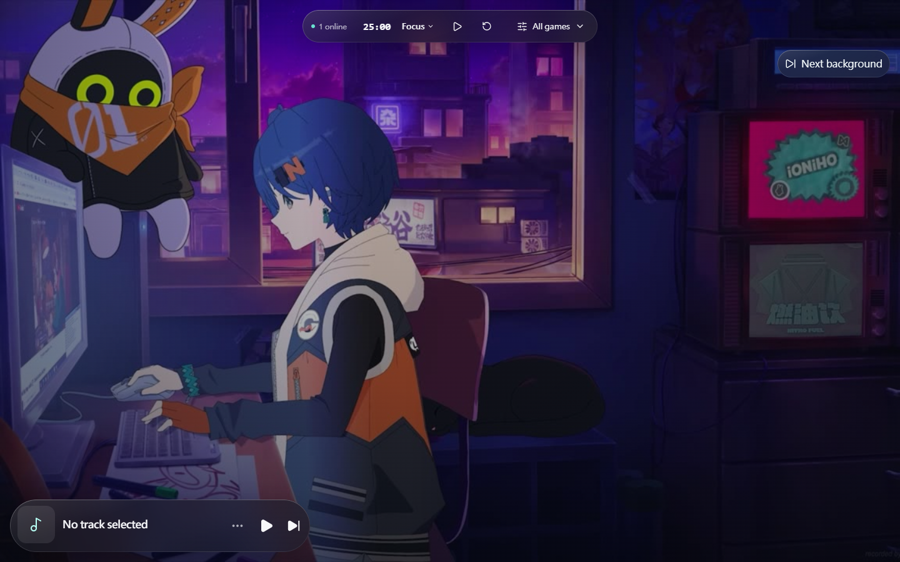
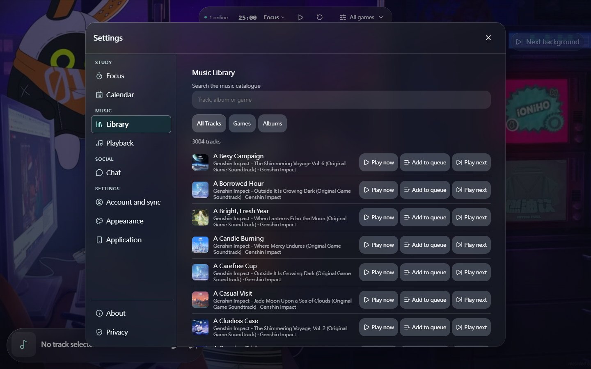
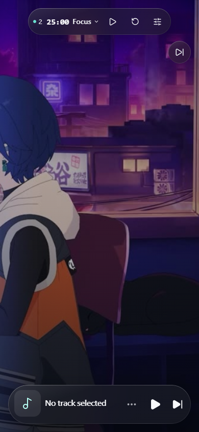
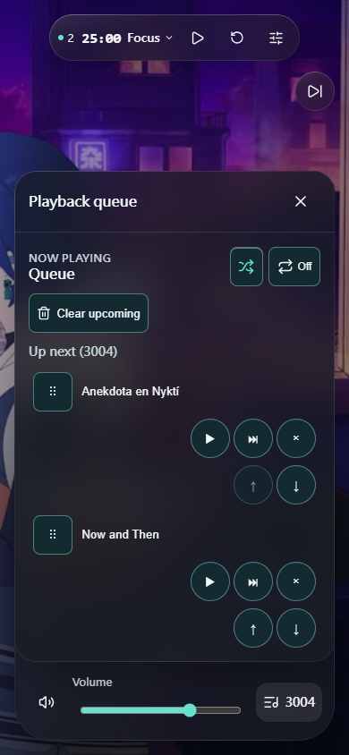

<div align="center">


# Study with HOYO-MiX

**一個以 HOYO-MiX 音樂陪伴學習的非官方粉絲專案。**

<p align="center">
  <a href="./README.md">English</a> |
  <a href="./README.zh_CN.md">简体中文</a> |
  <strong>繁體中文</strong>
</p>

<p align="center">
  <a href="LICENSE"></a>
  <a href="https://github.com/NullOkami47/study-with-hoyomix/commits/main"></a>
  <a href="https://github.com/NullOkami47/study-with-hoyomix/stargazers"></a>
  <a href="https://app.study-with-hoyomix.workers.dev"></a>
</p>

<p align="center">
  
  
  
  
</p>

<p align="center">
  <a href="#screenshots">介面預覽</a> •
  <a href="#capabilities">核心能力</a> •
  <a href="#implemented">已實作功能</a> •
  <a href="#planned-features">未來計畫</a> •
  <a href="#tech-stack">技術棧</a> •
  <a href="#quick-start">快速開始</a> •
  <a href="#project-layout">目錄結構</a> •
  <a href="#credits">致謝</a> •
  <a href="#links">友鏈</a> •
  <a href="#license">開源協議</a>
</p>

</div>

---

## 📝 專案簡介

**Study with HOYO-MiX**（[`NullOkami47/study-with-hoyomix`](https://github.com/NullOkami47/study-with-hoyomix)）是 [`NullOkami47/hoyomix_web_player`](https://github.com/NullOkami47/hoyomix_web_player) 的公開開源版本——一個以 **HOYO-MiX** 遊戲原聲音樂陪伴學習與專注的非官方深色系 Web 工作台。專案圍繞 WebGPU / WebGL2 / CSS **Liquid Glass（液態玻璃）** 光學材質打造，內建持久化番茄鐘與睡眠計時器、多音源播放編排引擎、基於原生 `IndexedDB` 的匿名本地優先曲庫與可選 OAuth 跨裝置雲端同步，以及基於 Cloudflare Workers + D1 + R2 + Durable Objects 的邊緣後端架構。

公開正式環境應用部署於 **[Study with HOYO-MiX](https://app.study-with-hoyomix.workers.dev)**，由 Cloudflare Worker `app` 提供服務。

- [建置與本地開發指南 (`BUILDING.txt`)](https://github.com/NullOkami47/study-with-hoyomix/blob/main/BUILDING.txt)
- [原始碼與開源授權聲明 (`NOTICE`)](https://github.com/NullOkami47/study-with-hoyomix/blob/main/NOTICE)
- [第三方開源聲明 (`docs/THIRD_PARTY_NOTICES.md`)](docs/THIRD_PARTY_NOTICES.md)

> [!IMPORTANT]
> **非官方粉絲專案與公開開源發行聲明**
>
> - **非官方與非商業性質**：Study with HOYO-MiX 是一個獨立的、非商業性質的粉絲自製學習陪伴專案，與米哈遊（HoYoverse / miHoYo / Cognosphere）或 HOYO-MiX **不存在任何隸屬、背書、贊助或授權關係**。相關遊戲名稱、角色與音樂商標均歸其各自權利人所有。
> - **不含受版權保護的媒體與線上憑證**：本公開開源發行版**刻意不包含任何原聲音樂曲庫、受版權保護的遊戲美術封面、動態遊戲桌布、使用者紀錄、預設第三方音源腳本或線上服務金鑰**。隨附的初始曲庫（`src/features/catalog/catalog.production.json` 與 `src/features/catalog/catalog.sample.json`）及靜態背景定義（`src/features/backgrounds/staticDefinitions.ts`）預設為空，供自託管部署者自行配置其擁有合法使用權的媒體資源與外部服務憑證。

> [!WARNING]
> **第三方音樂源與外部服務免責聲明**
>
> 第三方音樂源（包含使用者個人 ChKSz API Key 以及可選外部解析服務等）均依賴非本專案控制的外部服務。第三方介面可能因限流、地區限制、DNS/憑證錯誤或上游變更而失效。匯入或啟用第三方音源完全屬於使用者的個人行為，請遵守當地法律法規、目標平台服務條款與音樂版權規範。

<a id="screenshots"></a>
<a id="zh-tw-screenshots"></a>

## 📸 介面預覽

### 桌面版截圖

| 主頁 | 音樂庫 |
| :---: | :---: |
|  |  |

### 手機版截圖

| 主頁 | 播放佇列 |
| :---: | :---: |
|  |  |

<a id="capabilities"></a>
<a id="zh-tw-capabilities"></a>

## ⚡ 核心能力

| 模組領域 | 功能說明 |
| :--- | :--- |
| **液態玻璃工作台** | 雙槽位無縫交叉淡入淡出影片/海報背景舞台（預設 `1080p30`，可選 `1440p30` 高清源並在掉幀時自動回退），底層採用多通道 WebGPU / WebGL2 光學折射著色器（`StudioGlassCanvas`、`LiquidGlassCanvas`）及無依賴 CSS 降級方案 |
| **持久化計時與學習統計** | 基於單調時鐘的番茄工作法計時器（`focus`、`short-break`、`long-break`，支援休息階段自動暫停/恢復音樂租約）、持久化睡眠計時器（`15` / `30` / `45` / `60` / `90` 分鐘預設與自訂時長）以及 `StudyCalendar` 學習打卡統計 |
| **多維曲庫與虛擬化佇列** | 支援依遊戲（`genshin`、`hsr`、`zzz`）、氛圍模式（`sleep`、`focus`、`chill`）與關聯類型（`place`、`character`、`npc`、`faction`、`event`）篩選，結合 `opencc-js` 實作簡繁共通標題/別名搜尋，並提供可自由調整尺寸的虛擬捲動佇列 |
| **多音源播放編排** | 統一協調伺服器端與瀏覽器端音源轉接器（`r2`、`jellyfin`、`youtube`、`chksz`、`meting`、`gd-studio`、`huanyin`、`qijie`、`piped`、`invidious`、`lx`、`lx-user`），支援故障自動回退、系統 MediaSession 整合與即時延遲/錯誤碼診斷 |
| **QuickJS 自訂音源沙箱** | 支援匯入相容 LX Music 規範的 JavaScript 音源腳本，在獨立 Web Worker + `quickjs-emscripten-core` WebAssembly 沙箱（`src/features/player/lx/runtime/`）中受限執行，強制限制記憶體、呼叫堆疊、逾時與回應載荷大小 |
| **本地優先曲庫與雲端同步** | 免登入即可透過瀏覽器原生 `IndexedDB` 與 `localStorage` 儲存收藏曲目、自建歌單、可選播放歷史（最多保留 100 筆）與介面偏好；支援透過 **Google**、**GitHub**、**LINUX DO** 登入並將資料同步至 Cloudflare D1 |
| **即時自習室與管理後台** | 基於 Cloudflare Durable Objects（`OnlineCounter`）實作即時在線人數統計與公共自習聊天室；內建權限隔離的 `AdminShell`，支援管理曲庫版本、Google Sheets 匯入、R2 背景影片 WebCodecs 轉碼（`mediabunny`）、全站公告與音源健康度 |

<a id="implemented"></a>
<a id="zh-tw-implemented"></a>

## ✨ 已實作功能

#### 播放器、佇列與音質模型

- **緊湊單行與原地展開 `PlayerBar`**：預設單行展示安全封面回退、規範曲目標題、目前音源標識、播放/暫停與下一首按鈕；展開後原地顯示進度列、緩衝狀態、音量、佇列開關、音源切換與 `PlaybackDiagnostics` 診斷詳情。
- **非模態可調尺寸 `QueuePanel`**：表頭固定顯示隨機（`Shuffle`）與循環（`Repeat`）狀態，上方為歷史播放紀錄（`Previously Played`），中間固定「正在播放」（`Now Playing`）列，下方為虛擬捲動的「待播清單」（`Up Next`），支援 44 px 觸控/鍵盤排序與桌面端左下角控制柄自由縮放。
- **抽屜掛起不變式（Sheet Suspension）**：開啟任意模態面板（`SettingsSheet`、`LibrarySheet`、`ControlCentre`）時自動記錄播放意圖並安全暫停官方 YouTube IFrame 實例，關閉面板後精確恢復一次播放狀態。
- **音質檔位選擇（`src/features/player/qualityPreferences.ts`）**：
  - **ChKSz 音質模型（`src/shared/chksz.ts`）**：`standard`（標準）、`exhigh`（極高）、`lossless`（無損）、`hires`（Hi-Res）、`jyeffect`（高清環繞聲）、`sky`（沉浸環繞聲）、`jymaster`（超清母帶）。
  - **LX 自訂音源檔位**：`standard`、`high`、`lossless`、`hires`。
  - 當目標音質不可用時自動降級至可用資源，並在介面展示實際解析回傳的音質元資料。

#### 第三方音樂源與安全邊界

- **本地協議授權開關**：第三方解析源（`chksz`、`lx-user` 等）需在設定中閱讀並同意本地《第三方音源協議》（`ThirdPartyAgreement.vue`）後方可啟用，開關狀態完全由本地控制。
- **QuickJS WASM 執行環境（`src/features/player/lx/runtime/`）**：在獨立模組 Worker 中載入 `quickjs-emscripten-core` 與 `@jitl/quickjs-wasmfile-release-asyncify`（`0.32.0`），嚴格執行 `protocol.ts` 定義的記憶體上限、堆疊深度、執行逾時與橋接回應大小限制。
- **ChKSz 個人憑證支援**：支援使用者在應用內設定個人 `chksz_` API Key（需透過 LinuxDo 帳號於 `api.chksz.com` 註冊），用戶端與 Worker 端共用同一套 SSRF 與媒體網域校驗策略（`src/shared/chksz.ts`）。

<a id="planned-features"></a>
<a id="zh-tw-planned-features"></a>

## 🗂️ 未來可能添加功能 (新建文件夾中)

- **聊天室**
- **更多曲目，包括同人音樂**
- **更多第三方音樂來源**：支援更多第三方音樂來源，例如 LX Music
- **更好的液態玻璃 UI**
- **絕區零風格（電視機）UI**
- **原神風格 UI**
- **崩壞：星穹鐵道風格 UI**
- **平滑過渡**
- **智能混音**

<a id="tech-stack"></a>
<a id="zh-tw-tech-stack"></a>

## 🛠️ 技術棧

| 層級 | 技術實作 |
| :--- | :--- |
| **前端框架與響應式** | Vue 3.5 (Composition API, `<script setup>`), `@vueuse/core`, TypeScript 5.6, Vite 8.3 |
| **液態玻璃與樣式** | 自訂 CSS 設計令牌 (`src/styles/tokens.css`), WebGPU / WebGL2 多通道著色器 (`src/features/liquid-glass/`), Lucide Vue Next |
| **播放與媒體處理** | `HTMLAudioElement`, 官方 YouTube IFrame Player API, MediaSession API, `mediabunny` 1.61.1 (WebCodecs 影片轉碼與 MP4 校驗) |
| **自訂音源沙箱** | Web Worker + QuickJS WebAssembly (`quickjs-emscripten-core` & `@jitl/quickjs-wasmfile-release-asyncify` `0.32.0`) |
| **檢索與國際化** | 三語國際化 (`en`, `zh-Hans`, `zh-Hant`), `opencc-js` 1.4.2 + 預計算 CJK 簡繁折合表 (`src/features/catalog/hanFold.ts`) |
| **本地持久化** | 瀏覽器原生 `IndexedDB` (`src/features/library/localRepository.ts`, `src/features/focus/localRepository.ts`), `localStorage` (`src/utils/safeStorage.ts`), PWA (`vite-plugin-pwa`) |
| **邊緣後端與儲存** | Cloudflare Workers (`workers/index.ts`), Durable Objects (`workers/online-counter.js`), Cloudflare D1 (SQLite), Cloudflare R2 |
| **驗證與安全防護** | OAuth 2.0 / OIDC (Google, GitHub, LINUX DO), HMAC-SHA256 工作階段簽章與媒體票據, 嚴格的 Origin / CSRF / SSRF 防護 |
| **測試與工程化** | Vitest, `@vue/test-utils`, `fake-indexeddb`, `jsdom`, Miniflare, Wrangler 4 |

<a id="quick-start"></a>
<a id="zh-tw-quick-start"></a>

## 🚀 快速開始

#### 1. 環境需求

- **Node.js** `22.18.0` 或更新版本（建議使用 **Node.js 24 LTS**）
- **npm**（隨 Node.js 附帶）
- **Git**

#### 2. 安裝相依套件與啟動前端開發

```bash
# 嚴格依照 package-lock.json 安裝鎖定相依套件
npm ci

# 啟動本地 Vite 開發伺服器（自動解碼產生 PWA 圖示與建置資訊）
npm run dev
```

常用檢查、測試與建置指令：

```bash
npm run typecheck     # 產生建置資訊並執行 vue-tsc + tsc 靜態型別檢查
npm test              # 執行前端 Vitest 單元與元件測試
npm run test:workers  # 使用 Miniflare/Vitest 執行 Cloudflare Worker + D1 整合測試
npm run build         # 解碼產生 PWA 圖示、建置資訊並將前端產物打包至 dist/
npm run preview       # 本地預覽前端建置產物
npm run verify        # 依序執行 typecheck、前端測試、Worker 測試與正式建置
```

#### 3. 本地登入按鈕預覽 (`HOYOMIX_DEV_AUTH_PREVIEW`)

正常執行 `npm run dev` 會將驗證請求交給下游後端處理。若希望在無需真實驗證的情況下預覽全部三個登入按鈕（`Google`、`GitHub`、`LINUX DO`），請在開發伺服器的處理程序環境中明確設定 `HOYOMIX_DEV_AUTH_PREVIEW=1`：

```powershell
$env:HOYOMIX_DEV_AUTH_PREVIEW = '1'
try { npm run dev } finally { Remove-Item Env:HOYOMIX_DEV_AUTH_PREVIEW }
```

```sh
HOYOMIX_DEV_AUTH_PREVIEW=1 npm run dev
```

僅精確值 `1` 會啟用該 Mock；未設定、`0` 或 `true` 均保持關閉。請勿將其寫入受版本控制的環境檔案（Vite `.env` 檔案不會啟用該模式）。它僅對處於 `development` 模式的 Vite 開發伺服器生效，絕不會在正式或預發布建置、已部署環境或 `npm run preview` 中生效。

該 Mock 僅攔截精確的 `GET /api/auth/providers`（回傳三個可用提供商）、`GET /api/session`（回傳未登入 `401`）以及 `GET /api/auth/{google,github,linuxdo}/start`（回傳純文字 `501` 說明未執行真實 OAuth）。支援攜帶查詢字串（包含身分綁定查詢參數）。回應標頭包含 `X-Hoyomix-Dev-Auth-Mock: 1`，JSON 回應內容包含 `mock: true`。啟動端點不會重新導向、建立 Cookie/Token、登入或綁定身分；其餘請求方法與路由（含尾部斜線與回呼網址）均繼續向下游轉發。

#### 4. 重新產生 PWA 圖示

安裝圖示以純文字 Base64 原始碼形式儲存在 Git 中（`scripts/pwa-icons/pwa-icon-192.png.base64.txt` 與 `scripts/pwa-icons/pwa-icon-512.png.base64.txt`），以便拒絕二進位修補檔的程式碼審查系統也能完整傳遞 PWA 變更。產生的 PNG 點陣檔案已被 Git 忽略。

當需要點陣圖示檔案時，可直接執行解碼器：

```bash
npm run generate:pwa-icons
```

`npm run dev` 與 `npm run build` 會自動執行該解碼器。解碼器在寫入 `public/pwa-icon-192.png` 與 `public/pwa-icon-512.png` 之前，會校驗 Base64 語法、PNG 簽章、宣告尺寸與 SHA-256 摘要。

#### 5. 完整本地 Worker + D1 後端聯調環境

如需在本地執行完整的 Cloudflare Worker + 前端聯調環境：

1. 將 `.dev.vars.example` 複製為 `.dev.vars`（已被 Git 忽略）。
2. 在 `.dev.vars` 中產生相互獨立的 `SESSION_HMAC_SECRET` 與 `OAUTH_STATE_SECRET`（每個至少 32 隨機位元組）。切勿使用用戶端 `VITE_` 變數存放金鑰。
3. 可選 OAuth 與 Owner 引導：透過 `workers/auth/types.ts` 與 `workers/index.ts` 中的可選欄位設定您自己的 OAuth 應用程式憑證（`GOOGLE_*`、`GITHUB_*`、`LINUXDO_*`），並透過 `OWNER_PROVIDER` 與 `OWNER_SUBJECT` 明確指定管理員身分；保持未設定即可關閉登入提供商。
4. 初始化本地空白 D1 資料庫、建置前端並啟動 Wrangler：

```bash
npm run d1:migrate:local
npm run build
npm run dev:worker
```

開啟 `http://localhost:8787` 即可存取。儲存庫內建的 `wrangler.toml` 僅指向本地開發資源。

#### 6. 配置自有媒體與音源（開源發行版說明）

由於公開開源版本預設提供空白初始曲庫與背景清單：

- **音樂曲庫**：依照 `src/features/catalog/schema.ts` 定義的資料結構填充 `src/features/catalog/catalog.production.json`（及 `catalog.sample.json`），或透過 `workers/catalogue/` 使用曲庫管理後台與可選的 Google Sheets 匯入功能。新增曲目文字後如需重新產生可選的漢字簡繁折合表，可執行 `node scripts/generate-han-fold-table.mjs`。
- **音樂源服務**：在 `src/features/player/providers/registry.ts`、`workers/providers/routing.ts`、`workers/providers/config.ts` 與 `workers/index.ts` 中依需求啟用並設定您自己的 Jellyfin、R2 或解析服務資源。
- **背景舞台**：如需新增可再散佈的靜態背景，請更新 `src/features/backgrounds/staticDefinitions.ts` 並將對應檔案放入 `public/` 目錄；上傳動態影片背景則需明確設定 `BACKGROUND_BUCKET` R2 儲存貯體綁定。

<a id="project-layout"></a>
<a id="zh-tw-project-layout"></a>

## 📁 目錄結構

```text
study-with-hoyomix/
├── docs/
│   ├── licenses/                 # MIT、Apache-2.0 與執行階段相依套件授權條款全文
│   └── THIRD_PARTY_NOTICES.md    # 上游專案與第三方開源元件歸屬聲明
├── migrations/                   # Cloudflare D1 SQLite 資料庫遷移腳本 (0001–0028)
├── public/                       # PWA 清單、robots.txt、SVG 圖示與標題快取輔助腳本
├── scripts/
│   ├── pwa-icons/                # Base64 編碼的 192px 與 512px PNG 圖示原始碼
│   ├── generate-build-info.mjs   # 建置元資料產生腳本
│   ├── generate-han-fold-table.mjs # OpenCC CJK 簡繁搜尋折合表產生工具
│   ├── generate-pwa-icons.mjs    # 含 SHA-256 校驗的 Base64 轉 PNG 解碼器
│   └── public-notices.ts         # 提供 /legal/*.txt 法律聲明路由的 Vite 外掛
├── src/
│   ├── components/shell/         # 無障礙 AppShell 應用外殼與跳轉連結
│   ├── features/
│   │   ├── account/              # OAuth 工作階段、多平台身分綁定與 D1 偏好/曲庫同步
│   │   ├── admin/                # AdminShell 管理後台（曲庫、背景、公告、音源健康度）
│   │   ├── backgrounds/          # 雙槽位影片/海報背景狀態庫與 staticDefinitions.ts
│   │   ├── catalog/              # 曲庫 Schema 校驗、多維篩選器、OpenCC 與漢字折合檢索
│   │   ├── chat/                 # FloatingChatWindow 即時自習聊天視窗與安全停靠佈局
│   │   ├── focus/                # 番茄鐘記錄器、StudyCalendar 學習日曆與本地/遠端倉儲
│   │   ├── legal/                # FanProjectNotice 粉絲專案聲明元件與狀態庫
│   │   ├── library/              # MusicLibrary 音樂庫、專輯卡片、IndexedDB 倉儲與合併彈窗
│   │   ├── liquid-glass/         # WebGPU/WebGL2 多通道著色器、StudioGlassCanvas 與 NOTICE.md
│   │   ├── notices/              # 系統公告中心 (NoticeCentre) 與歷史公告
│   │   ├── player/               # PlayerBar、QueuePanel、QuickJS LX 沙箱與多音源轉接器
│   │   ├── settings/             # 統一八分區 SettingsSheet、LxSourceManager 與第三方協議
│   │   ├── timers/               # 基於單調時鐘的持久化番茄鐘與睡眠計時器狀態庫
│   │   └── workspace/            # StudyWorkspace 主工作台、FocusBar、ControlCentre、背景舞台
│   ├── i18n/                     # 三語國際化詞條 (en, zh-Hans, zh-Hant)
│   ├── pwa/                      # Service Worker 註冊、安裝狀態偵測與更新提示
│   ├── shared/                   # 用戶端與 Worker 共用的 ChKSz 校驗、比對與版本簽章邏輯
│   ├── stores/                   # 工作台全域偏好設定狀態庫
│   ├── styles/                   # Liquid Glass CSS 設計令牌 (tokens.css)
│   ├── test/                     # 前端單元測試、歸屬聲明校驗、執行階段契約與 Vite 設定測試
│   ├── types/                    # TypeScript 環境型別宣告
│   └── utils/                    # 安全本地儲存封裝 (safeStorage.ts)
├── tests/fixtures/               # 用於影片校驗測試的微型合成純色 MP4 與海報固件
├── workers/
│   ├── account/                  # 使用者偏好同步路由處理器
│   ├── admin/                    # 管理員權限校驗與後台 API 路由
│   ├── auth/                     # Google、GitHub 與 LINUX DO OAuth/OIDC 驗證流與工作階段簽章
│   ├── backgrounds/              # R2 背景媒體管理與 MP4 碼流規格校驗路由
│   ├── catalogue/                # D1 曲庫暫存、差異比對、發布與 Google Sheets 匯入
│   ├── focus/                    # 專注紀錄雲端同步路由
│   ├── library/                  # 個人曲庫雲端同步路由
│   ├── providers/                # 伺服器端音源設定、SSRF 防護、媒體代理與解析路由
│   ├── test/                     # 基於 Miniflare 的 Worker + D1 安全與整合測試套件
│   ├── index.ts                  # Cloudflare Worker 主入口
│   ├── online-counter.js         # OnlineCounter Durable Object (WebSocket 在線人數與聊天)
│   └── presence.ts               # 在線狀態路由輔助模組
├── BUILDING.txt                  # 本地開發與 Worker 環境建置說明
├── LICENSE                       # GNU 通用公共許可證 v3.0 (GPL-3.0)
├── NOTICE                        # 原始碼來源、修改紀錄與版權聲明
└── wrangler.toml                 # 本地 Cloudflare Workers、D1、R2 與 Durable Objects 設定
```

<a id="credits"></a>
<a id="zh-tw-credits"></a>

## 🙏 致謝 (Credits)

- https://github.com/lladlam/MeloX-Android
- https://github.com/iyinchao/liquid-glass-studio
- https://github.com/shshouse/StudyWithMiku

<a id="links"></a>
<a id="zh-tw-links"></a>

## 🔗 友鏈 (Links)

- [LINUX DO](https://linux.do/)

<a id="license"></a>
<a id="zh-tw-license"></a>

## 📄 開源協議與歸屬聲明

本專案實作基線衍生自 [StudyWithMiku](https://github.com/shshouse/StudyWithMiku) 的提交版本 [`7b094632d08a6599a1b334e6c6af41dc10ea6495`](https://github.com/shshouse/StudyWithMiku/tree/7b094632d08a6599a1b334e6c6af41dc10ea6495)。Study with HOYO-MiX 基於 **GPL-3.0** 許可證開源；詳見 [LICENSE](LICENSE)、[NOTICE](https://github.com/NullOkami47/study-with-hoyomix/blob/main/NOTICE) 與[第三方開源聲明](docs/THIRD_PARTY_NOTICES.md)。

後 MVP 階段的 LLM 曲目分類系統已從 MVP 計畫中獨立拆分。在獨立完成來源驗證與登記之前，本儲存庫不包含任何上游媒體資源。
