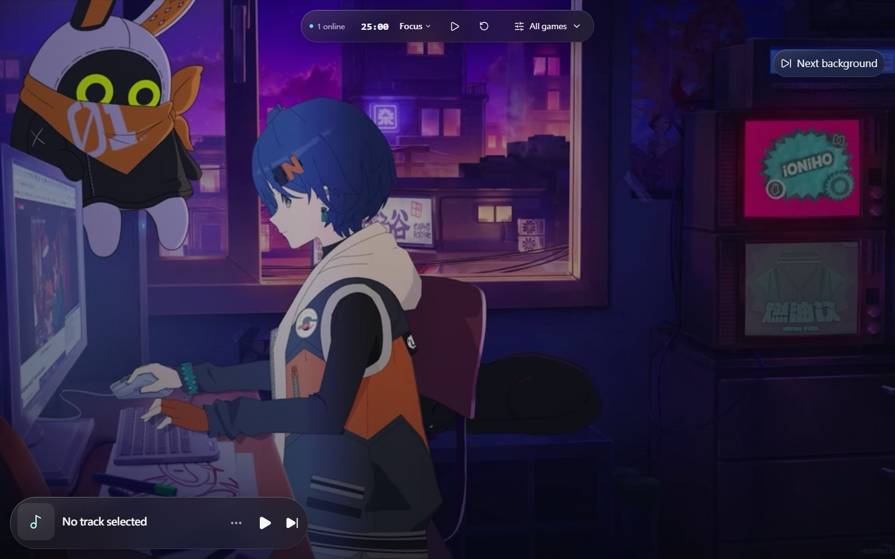
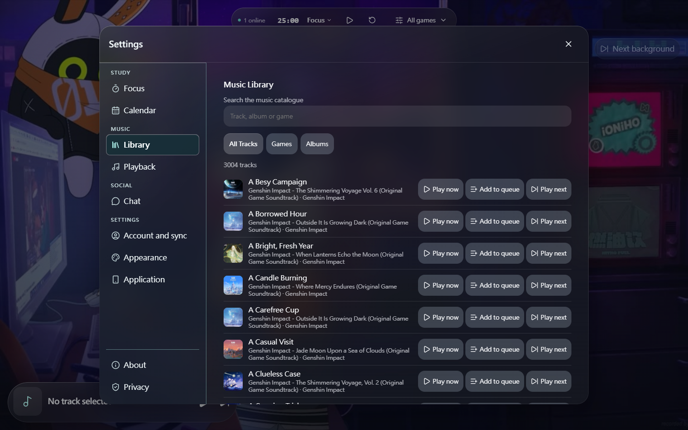
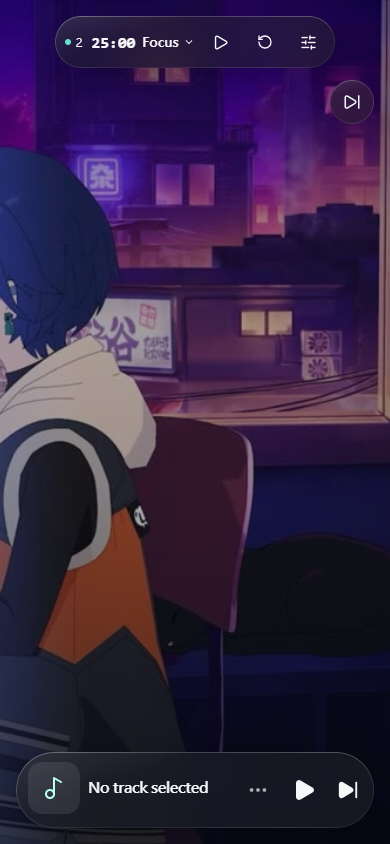
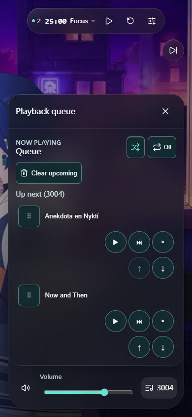

<div align="center">


# Study with HOYO-MiX

**一個以 HOYO-MiX 音樂陪伴學習的非官方粉絲專案。**

<p align="center">
  <a href="./README.md">English</a> |
  <a href="./README.zh_CN.md">简体中文</a> |
  <strong>繁體中文</strong>
</p>

<p align="center">
  <a href="https://github.com/NullOkami47/study-with-hoyomix/actions/workflows/public-ci.yml"></a>
  <a href="LICENSE"></a>
  <a href="https://github.com/NullOkami47/study-with-hoyomix/commits/main"></a>
  <a href="https://github.com/NullOkami47/study-with-hoyomix/stargazers"></a>
  <a href="https://app.study-with-hoyomix.workers.dev"></a>
</p>

<p align="center">
  
  
  
  
</p>

<p align="center">
  <a href="#screenshots">介面預覽</a> •
  <a href="#capabilities">核心能力</a> •
  <a href="#implemented">已實作功能</a> •
  <a href="#architecture-and-modules">架構說明</a> •
  <a href="#planned-features">未來計畫</a> •
  <a href="#tech-stack">技術棧</a> •
  <a href="#quick-start">快速開始</a> •
  <a href="#project-layout">目錄結構</a> •
  <a href="#credits">致謝</a> •
  <a href="#links">友鏈</a> •
  <a href="#license">開源協議</a>
</p>

</div>

---

## 📝 專案簡介

**Study with HOYO-MiX**（[`NullOkami47/study-with-hoyomix`](https://github.com/NullOkami47/study-with-hoyomix)）是一個以 **HOYO-MiX** 遊戲原聲音樂陪伴學習與專注的非官方深色系 Web 工作台。專案圍繞 WebGPU / WebGL2 / 預烘焙貼圖 / CSS **Liquid Glass（液態玻璃）** 光學材質打造，內建持久化番茄鐘與睡眠計時器、支援預載與過渡混音的多音源播放引擎、基於原生 `IndexedDB` 的匿名本地優先曲庫與可選 OAuth 雲端同步、即時社區聊天室，以及基於 Cloudflare Workers + D1 + R2 + Durable Objects 的邊緣後端架構。

公開正式環境應用部署於 **[Study with HOYO-MiX](https://app.study-with-hoyomix.workers.dev)**，由 Cloudflare Worker `app` 提供服務。

本儲存庫為公開開源發行版本，不包含任何私有維運腳本、部署金鑰或受版權保護的影音曲庫。

- [系統架構說明 (`docs/architecture.md`)](docs/architecture.md)
- [更新日誌 (`CHANGELOG.md`)](CHANGELOG.md)
- [建置與自託管指南 (`BUILDING.txt`)](BUILDING.txt)
- [原始碼與開源授權聲明 (`NOTICE`)](NOTICE)
- [第三方開源聲明 (`docs/THIRD_PARTY_NOTICES.md`)](docs/THIRD_PARTY_NOTICES.md)

> [!IMPORTANT]
> **非官方粉絲專案與公開開源發行聲明**
>
> - **非官方與非商業性質**：Study with HOYO-MiX 是一個獨立的、非商業性質的粉絲自製學習陪伴專案，與米哈遊（HoYoverse / miHoYo / Cognosphere）或 HOYO-MiX **不存在任何隸屬、背書、贊助或授權關係**。相關遊戲名稱、角色與音樂商標均歸其各自權利人所有。
> - **不含受版權保護的媒體與線上憑證**：本公開開源發行版**刻意不包含任何原聲音樂曲庫、受版權保護的遊戲美術封面、動態遊戲桌布、使用者紀錄、預設第三方音源腳本或線上服務金鑰**。初始曲庫（`catalog.production.json`、`catalog.sample.json`、`public/catalogue/v1.json`）與靜態背景定義（`staticDefinitions.ts`）預設為空，供自託管部署者自行配置擁有合法使用權的資源。

> [!WARNING]
> **第三方音樂源與外部服務免責聲明**
>
> 第三方音樂源（包含使用者個人 ChKSz API Key、自訂/全域 LX 腳本及可選外部解析服務）皆依賴非本專案控制的外部服務，可能因限流、地區限制、憑證錯誤或上游變更而失效。請遵守當地法律法規、平台服務條款與音樂版權規範。

<a id="screenshots"></a>
<a id="zh-tw-screenshots"></a>

## 📸 介面預覽

### 桌面版截圖

| 主頁 | 音樂庫 |
| :---: | :---: |
|  |  |

### 手機版截圖

| 主頁 | 播放佇列 |
| :---: | :---: |
|  |  |

<a id="capabilities"></a>
<a id="zh-tw-capabilities"></a>

## ⚡ 核心能力

| 模組領域 | 功能說明 |
| :--- | :--- |
| **液態玻璃工作台** | 雙槽位無縫交叉淡入淡出背景舞台（`SceneBackdrop`），結合 WebGPU / WebGL2 多通道光學折射著色器（`StudioGlassCanvas`、`LiquidGlassCanvas`、`AdaptiveGlassSurface`）、預烘焙折射紋理與遵循系統透明偏好的 CSS 降級方案 |
| **持久化計時與學習統計** | 基於單調時鐘的番茄工作法計時器（`focus`、`short-break`、`long-break`，支援休息暫停音樂租約）、持久化睡眠計時器（`15` / `30` / `45` / `60` / `90` 分鐘與自訂倒數計時）及 `StudyCalendar` 學習打卡統計 |
| **Vocal 分類、多維曲庫與虛擬佇列** | 支援依遊戲（`genshin`、`hsr`、`zzz`）、模式（`sleep`、`focus`、`chill` 與獨立的 Vocal/人聲分類篩選）與關聯實體篩選，`opencc-js` 簡繁共通檢索，以及支援隨機（Shuffle）與循環（`off`/`all`/`one`）的可調尺寸虛擬捲動佇列 |
| **多音源播放、過渡與統一恢復** | 協調現行活躍音源（`chksz`、`lx`、`gd-studio`；Jellyfin 與 Vkeys 已退役），提供 `requestSourceRecovery` 統一恢復鏈（10 秒冷卻期內同源票據續期後順位回退）、下一曲預載、**無過渡 / 平滑淡入淡出 / Smart Mix 智慧混音**（2–12 秒）、專輯封面本地快取、行動端背景交接最佳化與 `PlaybackDiagnostics` |
| **QuickJS 自訂與全域 LX 源** | 在獨立 Web Worker + `quickjs-emscripten-core` WebAssembly 沙箱中執行個人或管理員發佈的全域 LX 腳本，結合 Worker 端 `acorn` 詞法中繼資料校驗、內容雜湊與顯式 `LX_ALLOWED_ORIGINS` CSP 策略 |
| **本地優先曲庫與雲端同步** | 免登入即可透過 `IndexedDB` 與 `localStorage` 儲存收藏、自建歌單與可選播放紀錄（最多 100 筆）；支援透過 **Google**、**GitHub**、**LINUX DO** 登入並同步至 Cloudflare D1 |
| **社區聊天室與管理後台** | 基於 `ChatRoom` SQLite Durable Object 與 D1 的即時自習聊天室（編輯/回覆、表情貼紙、封鎖與檢舉、受限正則關鍵字過濾、版主審核與保留恢復機制），搭配 `OnlinePresence` 在線人數統計及權限隔離的 `AdminShell`（曲庫版本與發現入庫、Google Sheets 匯入、R2 影片轉碼、全站公告、音源健康度與排序） |

<a id="implemented"></a>
<a id="zh-tw-implemented"></a>

## ✨ 已實作功能與架構邊界

- **現行與退役/相容音源**：公開版本預設僅於播放鏈註冊現行規範音源 `chksz`、`lx`、`gd-studio` 並提供伺服器端 SSRF/媒體票據/容器標頭校驗。**Jellyfin** 與 **Vkeys** 已完全退役（不參與設定與偏好且管理路由回傳 `404`）；舊版 `r2`/`meting`/`piped`/`invidious`/`qijie`/`lx-huanyin`/`lx-huibq`/`lx-ikun` 等識別項未於預設前端執行階段啟用，僅在未明確設定時維持停用，並保留伺服器端安全契約測試、歷史曲目校驗與曲庫發現（`workers/catalogue/discovery/`）相容層。
- **社區聊天室與在線狀態**：採用獨立的 `ChatRoom` SQLite Durable Object 與 `OnlinePresence` Durable Object 邊界；聊天傳送提供冪等憑據（`requestId`）去重、限流與排程保留恢復機制（`docs/chat-retention-recovery.md`）。
- **曲庫發現與輔助工具**：包含管理員發現收件匣（`workers/catalogue/discovery/`）以及獨立可執行的 Python 中繼資料發現工具包 `tools/catalog-sync/`，預設關閉自動入庫與發佈。
- **已知限制與實機驗收說明**：前端與 Worker 整合測試已完整驗證狀態機、恢復與安全邊界，但**尚未於真實 Android / iOS 實體裝置上執行鎖屏與 PWA 安裝態背景連續播放實測**；自託管部署者在正式啟用前應於目標實體裝置上完成端對端音訊、WebSocket 與 OAuth 驗證。此外，僅支援 HTTP 的 API 代理無法轉發 WebSocket，聊天室需同源 Worker 或支援 WebSocket 的反向代理。

<a id="planned-features"></a>
<a id="zh-tw-planned-features"></a>

## 🗂️ 未來可能添加功能

- **更多曲目支援與合規二創擴充**：在完成版權與來源審計後完善公開曲庫擴充流程。
- **更佳的液態玻璃渲染表現**：持續最佳化行動端 GPU 渲染效能。
- **遊戲主題介面探索**：絕區零（電視機/CRT）、原神、崩壞：星穹鐵道風格主題。
- **更多音源與格式相容驗證**：在確保穩定性與合規性的前提下評估更多音源轉接器。

<a id="tech-stack"></a>
<a id="zh-tw-tech-stack"></a>

## 🛠️ 技術棧

| 層級 | 技術實作 |
| :--- | :--- |
| **前端框架** | Vue 3.5 (`<script setup>`), TypeScript 5.6, Vite 8.3 |
| **液態玻璃與樣式** | CSS 設計令牌 (`src/styles/tokens.css`), WebGPU / WebGL2 多通道著色器 (`src/features/liquid-glass/`), 預烘焙折射紋理, Lucide Vue Next |
| **播放與媒體處理** | 雙槽 `HTMLAudioElement`, 官方 YouTube IFrame Player API, MediaSession API, `mediabunny` 1.61.1 (WebCodecs 影片轉碼與 MP4 校驗) |
| **自訂音源沙箱** | Web Worker + QuickJS WASM (`quickjs-emscripten-core` & `@jitl/quickjs-wasmfile-release-asyncify` `0.32.0`) + Worker 端 `acorn` (`8.15.0`) 詞法檢查 |
| **檢索與國際化** | 三語國際化 (`en`, `zh-Hans`, `zh-Hant`), `opencc-js` 1.4.2 + 簡繁折合表 (`hanFold.ts`) |
| **本地持久化** | `IndexedDB`, `localStorage`, PWA (`vite-plugin-pwa` `1.3.0`) |
| **邊緣後端與儲存** | Cloudflare Workers (`workers/index.ts`), Durable Objects (`OnlinePresence`, SQLite `ChatRoom`), Cloudflare D1 (`0001`–`0033`), Cloudflare R2 |
| **驗證與安全防護** | OAuth 2.0 / OIDC (Google, GitHub, LINUX DO), HMAC-SHA256 工作階段與媒體票據, Origin / CSRF / SSRF 防護 |
| **測試與工具** | Vitest 5, `@vue/test-utils`, `fast-check`, `fake-indexeddb`, `jsdom`, Miniflare, Wrangler 4, Python `pytest` (`tools/catalog-sync`) |

<a id="quick-start"></a>
<a id="zh-tw-quick-start"></a>

## 🚀 快速開始與自託管部署

1. **安裝與開發**：需要 Node.js `>=22.18.0`（可選 Python `>=3.10` 用於 `tools/catalog-sync`）：

```bash
npm ci --no-audit --no-fund
npm run dev
```

2. **常用檢查、測試與建置指令**：

```bash
npm run typecheck
npm test
npm run test:workers -- --maxWorkers=2
npm run build
npm run d1:migrate:local
npm audit --omit=dev --audit-level=high
```

3. **環境變數與本地完整環境**：
   - 將 `.dev.vars.example` 複製為 `.dev.vars` 並填入隨機產生且互不相同的 `SESSION_HMAC_SECRET` / `OAUTH_STATE_SECRET`（至少 32 位元組），依需求填入 OAuth、`OWNER_PROVIDER`/`OWNER_SUBJECT`、`CHKSZ_API_KEY`、`GD_STUDIO_*`、`LX_ALLOWED_ORIGINS`、`R2_*` 等伺服器端設定；前端非機密選項參考 `.env.example`（嚴禁將金鑰寫入 `VITE_*`）。
   - 執行 `npm run d1:migrate:local && npm run build && npm run dev:worker` 啟動完整本地聯調，開啟 `http://localhost:8787`。
   - 開發環境如需無 OAuth 預覽登入按鈕，可在啟動時傳入 `HOYOMIX_DEV_AUTH_PREVIEW=1`（僅於 `development` 模式下生效）。
   - 更多細節請參閱 [`BUILDING.txt`](BUILDING.txt)、[`docs/public-ci.md`](docs/public-ci.md) 與 [`docs/architecture.md`](docs/architecture.md)。

<a id="project-layout"></a>
<a id="zh-tw-project-layout"></a>

## 📁 目錄結構

```text
study-with-hoyomix/
├── .github/workflows/public-ci.yml   # 公開 Hosted CI 與 All public checks 門禁
├── docs/                             # 架構說明、聊天室/保留恢復指南、CI 文件與第三方授權條款
├── migrations/                       # Cloudflare D1 SQLite 資料庫遷移腳本 (0001–0033)
├── public/                           # PWA 清單、液態玻璃折射貼圖與空初始曲庫
├── scripts/                          # 建置資訊、PWA 圖示解碼器、折射貼圖校驗與密鑰掃描腳本
├── src/                              # Vue 前端模組（account/admin/backgrounds/catalog/chat/focus/glass/legal/library/liquid-glass/notices/player/settings/timers/workspace）
├── tests/fixtures/                   # 微型純色合成 MP4 與封面測試固件
├── tools/catalog-sync/               # 獨立 Python 中繼資料發現套件與單元測試
├── workers/                          # Cloudflare Worker（account/admin/auth/backgrounds/catalogue/chat/focus/library/lx/providers/presence/test）
├── BUILDING.txt, CHANGELOG.md, LICENSE, NOTICE, wrangler.toml, .dev.vars.example, .env.example
```

<a id="credits"></a>
<a id="zh-tw-credits"></a>

## 🙏 致謝 (Credits)

- [shshouse/StudyWithMiku](https://github.com/shshouse/StudyWithMiku) — 本專案基於其 GPL-3.0 程式碼基線衍生。
- [iyinchao/liquid-glass-studio](https://github.com/iyinchao/liquid-glass-studio) — 液態玻璃渲染器與著色器部分元件遵循 MIT 協議沿用。
- 完整的上游專案致謝與執行階段開源元件授權（含 `acorn` 8.15.0 MIT、`opencc-js`、`quickjs-emscripten`、`mediabunny` MPL-2.0 等）請參閱 [`docs/THIRD_PARTY_NOTICES.md`](docs/THIRD_PARTY_NOTICES.md)。

<a id="links"></a>
<a id="zh-tw-links"></a>

## 🔗 友鏈 (Links)

- [LINUX DO](https://linux.do/)

<a id="license"></a>
<a id="zh-tw-license"></a>

## 📄 開源協議與歸屬聲明

本專案實作基線衍生自 [StudyWithMiku](https://github.com/shshouse/StudyWithMiku) 提交 [`7b094632d08a6599a1b334e6c6af41dc10ea6495`](https://github.com/shshouse/StudyWithMiku/tree/7b094632d08a6599a1b334e6c6af41dc10ea6495)，基於 **GPL-3.0** 協議開源；詳見 [`LICENSE`](LICENSE)、[`NOTICE`](NOTICE) 與 [`docs/THIRD_PARTY_NOTICES.md`](docs/THIRD_PARTY_NOTICES.md)。
